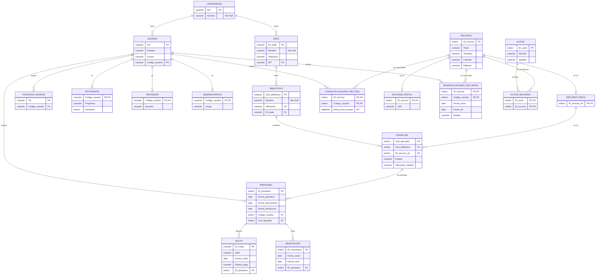
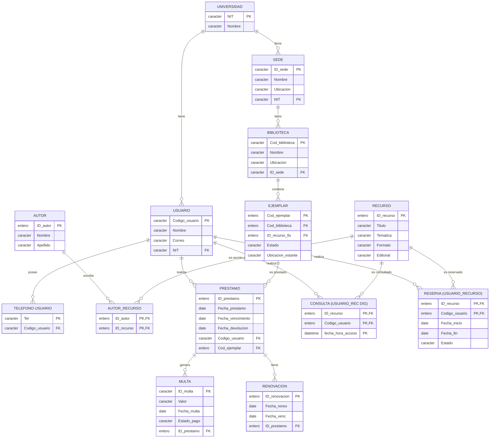

# Sistema de gestión de una biblioteca universitaria
## Tabla de Contenido

* [1. Contexto del problema y conceptos importantes](#1-contexto-del-problema-y-conceptos-importantes-en-la-temática-de-sistema-de-gestión-de-una-biblioteca-universitaria)
* [2. Tendencias actuales en dichos conceptos](#2-tendencias-actuales-en-dichos-conceptos)
* [3. Consultar y analizar al menos 2 herramientas existentes](#3-consultar-y-analizar-al-menos-2-herramientas-existentes-en-el-mercado-para-el-problema-o-situación-asignado)
* [4. Diagrama Entidad Relación](#4-diagrama-entidad-relación)
* [5. Introducción y Justificación del Nivel de Normalización](#5-introducción-y-justificación-del-nivel-de-normalización)
* [6. Análisis del Modelo Entidad - Relación](#6-análisis-del-modelo-entidad---relación)
* [7. Primera Forma Normal](#7-primera-forma-normal)
* [8. Segunda Forma Normal](#8-segunda-forma-normal)
* [9. Tercera Forma Normal](#9-tercera-forma-normal)
* [10. Modelo Relacional Final](#10-modelo-relacional-final)
* [11. Implementación en SQL](#11-sql)
    * [11.1 Creación de tablas](#111-creación-de-tablas)
    * [11.2 Inserción de datos](#112-inserción-de-datos)
    * [11.3 Consultas](#113-consultas)
* [12. Referencias Bibliográficas](#12-referencias-bibliográficas)

---
### Integrantes
| Nombre | Código |
| :--- | :--- |
| María Bueno | 2243504 |
| María Escalante | 2242732 |
| Karol Lizarazo | 2243131 |
| Mariana Martínez | 2242746 |
| Kenneth Silva | 2242735 |
| Juliana Serrano | 2221122 |


---
# CONSULTA DE EXPLORACIÓN
## 1. Contexto del problema y conceptos importantes en la temática de sistema de gestión de una biblioteca universitaria

Para las bibliotecas existe la necesidad latente de organizar y automatizar los procesos como consulta, préstamo, devolución, renovación y reserva de recursos bibliográficos, de acuerdo con su disponibilidad. La implementación de un sistema de gestión de bibliotecas permite optimizar la administración de libros, tesis, revistas y otros recursos en diferentes formatos, facilitando su organización y consulta, evitando conflictos en los préstamos y mejorando la experiencia de los usuarios de una universidad: estudiantes, docentes y administrativos.

### Sistema de Gestión de Bibliotecas
Se refiere a un conjunto automatizado que contemple las funciones de recopilación, almacenamiento, búsqueda y distribución del material bibliográfico de forma que se puedan satisfacer las necesidades y demandas de la institución, y al mismo tiempo mejorar la experiencia de los usuarios.

### Usuarios (estudiantes, docentes y administrativos)
Para los usuarios en general el sistema de gestión debe contar con un panel administrativo de usuario que permita la búsqueda sistemática de recursos, verificación de la disponibilidad, la solicitud y el seguimiento en los préstamos, guardar colecciones de recursos previos, la gestión de pagos en el caso de multas y otras acciones que mejoren la experiencia al usuario.

### Libros y otros recursos bibliográficos
Contempla la adquisición, donación o canje de los recursos bibliográficos con otras organizaciones y distribuidores, sean libros, tesis, revistas y/o recursos audiovisuales en distintas áreas del conocimiento. Asegurando un acceso a información internacional y la calidad en la recuperación de la información por parte del usuario, para lo que se requiere aplicar criterios de selección que garanticen la veracidad y relevancia de los recursos adquiridos tanto físicos como digitales.

### Préstamo y devolución del material
Implica la administración por parte de los usuarios de las solicitudes para adquirir recursos físicos de la biblioteca, en una red que actualice la disponibilidad y establezca el cronograma para el recurso determinado de forma que se eviten superposiciones en el préstamo de materiales.

### Renovación de préstamos
Aplica para los materiales físicos de la biblioteca, y es la extensión del tiempo de uso de un recurso ya prestado, sujeta a la disponibilidad del material (que no esté reservado por otro usuario) y la verificación de paz y salvos o el sobrepaso del límite de renovaciones permitidas, de forma que se asegure que otros usuarios también puedan prestar el material.

### Reserva de libros
Una reserva se trata de pedirle a la biblioteca que cuando un documento que en ese momento se encuentra prestado, tengamos la prioridad para pedirlo prestado.

Se debe tener en cuenta que, solo se puede reservar sobre ejemplares prestados, la reserva se realiza sobre un ejemplar específico y no sobre un título. Además, la biblioteca tiene la obligación de informar sobre el tiempo de espera al usuario.

### Catálogo bibliográfico
Es un registro organizado que contiene la descripción de todos los materiales disponibles en una biblioteca incluye libros, revistas, tesis, entre otros. Cada registro comprende datos como autor, editorial, título, año de publicación, clasificación y ubicación del material bien sea física o digital.

### Disponibilidad de ejemplares
Se refiere a la disponibilidad del material dentro de la biblioteca, bien sea disponibilidad física o digital de la revista, libro, artículo, tesis u otros recursos.

### Multas por retraso o no devolución
Las multas son sanciones administrativas aplicadas a los usuarios que incumplen con los plazos estipulados para la entrega del material. Estas pueden ser recargos económicos, suspensión temporal o restricciones para realizar reservas u otros servicios, todo ello de acuerdo a las políticas propias de la biblioteca.

### Gestor de bases de datos
Los gestores de datos comprenden como una capa intermedia entre los programas que utiliza el usuario y el sistema operativo del mismo. Son los encargados de establecer comunicación entre los dos sistemas indicados anteriormente. Este gestor presta los siguientes servicios: definición y creación de la base de datos, manipulación de los datos, acceso controlado de los datos por medio de mecanismos de seguridad, mantener la integridad de los datos, mecanismos de copias de respaldo y recuperación con el fin de poder restablecer la información en caso de fallos del sistema.

---

## 2. Tendencias actuales en dichos conceptos

Las tendencias actuales en los sistemas de gestión de bibliotecas (ILS) se encaminan hacia el almacenamiento de información en la nube, la asistencia con inteligencia artificial para el uso de chatbots, la implementación de sistemas de recomendación de lecturas y la optimización de procesos internos. Con la finalidad de ofrecer una mejor organización y recuperación de información lo que permite mejorar la eficiencia y experiencia del usuario.

Los ILS cuentan con un modelo de usuarios, basado en el rol que le corresponde a cada persona; dependiendo del rol que desempeñan pueden obtener ciertos beneficios adicionales o controles administrativos, gestionados idealmente mediante un sistema de identidad digital única. Asimismo los libros y otros recursos bibliográficos se registran en la nube donde se almacenan en un único sistema integrado que centraliza y optimiza tareas operativas esenciales como la catalogación, consultas, registros de usuarios, préstamos, devoluciones y renovación automatizada.

Los sistemas gestores de bases de datos (SGBD) permiten la creación, gestión y administración de bases de datos, así como el manejo y elección de las estructuras necesarias para el almacenamiento y búsqueda de información para garantizar la máxima eficiencia en el acceso a los datos. Por ejemplo, para la búsqueda de algún material el usuario puede ingresar palabras pertenecientes al título del material, el autor, el tema, el código de barras, además se puede filtrar el contenido por rango de publicación, idioma, ubicación o disponibilidad.

Otra tendencia importante en los sistemas de gestión de bibliotecas es la integración con otras plataformas institucionales, usando APIs y herramientas que permiten el intercambio de información con sistemas académicos, repositorios digitales y plataformas de aprendizaje.

También se han incorporado herramientas de análisis de datos que permiten generar estadísticas sobre el uso de los servicios y los recursos, identificar patrones de consulta y facilitar la toma de decisiones; estas herramientas pueden complementarse con inteligencia artificial y aprendizaje automático para analizar mucha información y ofrecer recomendaciones de contenido de acuerdo con los intereses y necesidades de los usuarios.

Por otra parte, la seguridad y protección de la información se han convertido en aspectos fundamentales debido al manejo de datos personales y registros de actividad. Los sistemas actuales incorporan mecanismos de autenticación, autorización, control de acceso, copias de seguridad y protección de las bases de datos para garantizar la confidencialidad, integridad y disponibilidad de la información. También existe una tendencia hacia la automatización y el acceso multiplataforma, permitiendo que los servicios puedan ser utilizados desde computadores y dispositivos móviles, mientras que diferentes procesos administrativos se realizan de forma automática, reduciendo la intervención manual y mejorando la eficiencia general del sistema.

---

## 3. Consultar y analizar al menos 2 herramientas existentes en el mercado para el problema o situación asignado

Para resolver la situación asignada, en este caso, un sistema de gestión de una biblioteca universitaria, actualmente el mercado ofrece software especializado tipo ILS (*Integrated Library System*) y repositorios institucionales, que permiten automatizar procesos como préstamos, catalogación, control de usuarios y acceso a la información. Se analizaron dos herramientas de código abierto ampliamente adoptadas por instituciones académicas:

### Koha
Es uno de los sistemas de biblioteca más comunes, conocido porque se puede personalizar por completo y adaptar a las necesidades de una institución en específico (software de código abierto). Este sistema permite la gestión de los datos relacionados con el ciclo físico de los libros existentes en una biblioteca (préstamos, devoluciones, reservas, multas), además, es capaz de gestionar colecciones digitales dentro del mismo catálogo y aplicación. Incluye un catálogo público en línea (OPAC), donde los usuarios pueden buscar, consultar y comprobar la disponibilidad de los distintos materiales (tanto físicos como digitales).

### DSpace
Es una plataforma creada para guardar y dar acceso abierto a la producción académica de una institución como tesis, artículos e informes de investigación, en lugar de gestionar el préstamo de documentos físicos. Organiza y facilita el acceso a recursos académicos para estudiantes e investigadores en diferentes disciplinas. Inicialmente fue desarrollada en el MIT y Hewlett-Packard, y ha sido usada por más de 3.000 instituciones en el mundo, con la misión de capturar, almacenar, indexar, preservar y redistribuir la producción intelectual de una organización.

### Tabla comparativa

| Aspecto | Koha | DSpace |
|---|---|---|
| **¿Para qué sirve?** | Gestionar préstamos físicos y también colecciones digitales | Almacenar y dar acceso a documentos digitales |
| **¿Qué gestiona?** | Circulación, catálogo, usuarios, multas, colecciones digitales | Tesis, artículos, trabajos de investigación |
| **Diferencia** | Circulación (préstamos y devoluciones) | Preservación y acceso abierto a documentos digitales |
| **Costo** | Gratuito (software libre) | Gratuito (software libre) |

El uso y selección del software depende netamente de las necesidades y problemáticas de la institución, donde deberán primar los aspectos más importantes para ellos.

---

## 4. Diagrama Entidad Relación


---
# INFORME DE NORMALIZACIÓN DE BASE DE DATOS
---
### 5. Introducción y Justificación del Nivel de Normalización

Este documento detalla el proceso de transformación del Modelo Entidad-Relación presentado con anteriorirdad del sistema de biblioteca universitaria a un Modelo Relacional normalizado. 

**Justificación del nivel alcanzado:**
El objetivo principal de la normalización es eliminar la redundancia de datos y evitar anomalías de inserción, actualización y eliminación. Para este sistema se ha decidido normalizar hasta la `Tercera Forma Normal`. 

Llegar a 3FN garantiza que:
1.  Cada dato se almacene en un solo lugar.

2.  Las actualizaciones como el cambio de estado de un préstamo o el pago de una multa sean consistentes y eficientes.

3.  Se mantenga la integridad referencial mediante el uso de llaves primarias (PK) y foráneas (FK).

No se aplicó la Forma Normal de Boyce-Codd (FNBC) ni la Cuarta (4FN) de manera estricta porque, si bien el sistema maneja jerarquías, el modelo relacional propuesto con tablas separadas para subtipos ya resuelve los problemas de dependencias multivaluadas y redundancias sin fragmentar en exceso el esquema, lo que facilitaría las consultas y el rendimiento general del sistema.

---

### 6. Análisis del Modelo Entidad - Relación

Partimos del diagrama conceptual donde identificamos entidades, atributos y relaciones. En este estado, existen problemas potenciales si intentáramos crear una sola tabla global o tablas sin normalizar:

*   **Atributos Multivaluados:** La entidad "Usuario" tiene el atributo "Teléfono" (un usuario puede tener varios teléfonos).

*   **Relaciones N:M:** Existen relaciones de muchos a muchos como "Consulta" (Usuario - Recurso Digital), "Reserva" (Usuario - Recurso) y "Escrito" por (Autor - Recurso).

*   **Jerarquías:** La entidad "Usuario" se especializa en "Estudiante", "Profesor" y "Administrativo". 
La entidad "Recurso" se especializa en "Recurso Digital" y "Recurso Físico".

*   **Atributos Derivados/Redundantes:** Si no se separan correctamente, datos como la ubicación o el NIT podrían repetirse innecesariamente.

---

### 7. Primera Forma Normal

**Regla:** Eliminar grupos repetidos y atributos multivaluados. Cada celda debe contener un valor atómico. Se deben definir llaves primarias.

**Aplicación al modelo:**
1.  **Atributo Multivaluado (Teléfono):** Se extrae de la entidad "Usuario" y se crea una nueva tabla llamada "TELEFONO_USUARIO". La llave primaria de esta nueva tabla es el propio número de "Teléfono"  y el "Código Usuario" actúa como llave foránea.

2.  **Relaciones N:M:** Se convierten en entidades asociativas o tablas intermedias:
    *   CONSULTA
    *   RESERVA
    *   AUTOR_RECURSO

3.  **Definición de PKs:** Cada entidad base recibe su llave primaria correspondiente. 

**Aclaracion**
En este punto, las jerarquías aún no están resueltas, por lo que los atributos específicos de Estudiantes, Profesores y Administrativos aún podrían estar mezclados en USUARIO o en tablas separadas temporalmente, pero las relaciones N:M ya se resolvieron.

**Diagrama del Modelo en 1FN:**


---

### 8. Segunda Forma Normal

**Regla:** Estar en 1FN y eliminar las dependencias parciales. Ningún atributo que no sea llave debe depender de una parte de la llave primaria. Esta regla aplica únicamente a las tablas que poseen llaves primarias compuestas.

**Aplicación al modelo:**
En nuestro diseño, la mayoría de las entidades ya cuentan con llaves primarias simples, por lo que automáticamente cumplen con esta forma normal. 

Sin embargo, debemos verificar las tablas asociativas creadas en el paso anterior para resolver las relaciones N:M:
*   **CONSULTA**: Su llave primaria es compuesta "ID_recurso", "Codigo_usuario", "fecha_hora_acceso". No posee atributos adicionales, por lo que no hay dependencias parciales.

*   **RESERVA**: Su llave primaria es compuesta "ID_recurso", "Codigo_usuario. Los atributos "Fecha_inicio", "Fecha_fin" y "Estado" dependen funcionalmente de la combinación de ambos, no de uno solo. Por lo tanto, cumple 2FN.

*   **AUTOR_RECURSO**: Su llave primaria es "ID_autor", "ID_recurso". No tiene atributos adicionales, por lo que cumple 2FN.

**Diagrama del Modelo en 2FN:**


---

### 9. Tercera Forma Normal

**Regla:** Estar en 2FN y eliminar dependencias transitivas. Ningún atributo que no sea llave debe depender de otro atributo que no sea llave. En otras palabras, los atributos no clave deben depender únicamente de la llave primaria.

**Aplicación al modelo:**

1.  **Jerarquía de Usuarios :**
    *   "Usuario" tiene atributos como "Semestre", "Programa" para estudiantes, "Escuela" para profesores y "Cargo" para administrativos.

    *   Si dejáramos todo en una sola tabla "USUARIO", tendríamos dependencias transitivas y una gran cantidad de valores nulos. 
    Por ejemplo:
    *Código usuario -> Tipo de usuario -> Cargo* 
    El "Cargo" depende del tipo de usuario, no directamente del código.

    *   **Solución:** Se crean las tablas "ESTUDIANTE", "PROFESOR" y "ADMINISTRATIVO". Estas heredan la llave primaria de "USUARIO". Los atributos específicos se mueven a estas tablas.

2.  **Jerarquía de Recursos:**
    *   Ocurre lo mismo con "Recurso". Si tuviéramos "URL" en la tabla general, aplicaría solo a los digitales.

    *   **Solución:** Se crean "RECURSO DIGITAL" y "RECURSO FÍSICO". El "RECURSO DIGITAl" añade el atributo "URL", mientras el  "RECURSO FÍSICO" no añade atributos propios en este modelo, pero sirve como puente para la relación con "EJEMPLAR".

3.  **Dependencias Transitivas en la ubicación geográfica:**
    *   Una "BIBLIOTECA" pertenece a una "SEDE", y una "SEDE" pertenece a una "UNIVERSIDAD".

    *   Si pusiéramos el "NIT" de la universidad directamente en "BIBLIOTECA", tendríamos una dependencia transitiva *Cod_biblioteca -> ID_sede -> NIT*

    *   **Solución:** La tabla "BIBLIOTECA" solo guarda "ID_sede" como llave foránea. El "NIT" se obtiene haciendo un JOIN con "SEDE".

4.  **Dependencias Transitivas en Préstamos y Multas:**
    *   Una "MULTA" se genera por un "PRESTAMO".

    *   Si guardáramos el "Código usuario" en "MULTA", sería una dependencia transitiva *ID_multa -> ID_prestamo -> Código usuario*.

    *   **Solución:** La tabla "MULTA" solo guarda "ID_prestamo" como llave foránea. El usuario se obtiene a través del préstamo. Está misma idea se aplica para "RENOVACION".

---

### 10. Modelo Relacional Final

Como resultado de aplicar las tres primeras formas normales, obtenemos el siguiente esquema relacional. Este esquema elimina la redundancia, asegura la integridad de los datos y coincide exactamente con el modelo lógico propuesto.

**Diagrama del Modelo Relacional Final:**


---

## 11. SQL

La base de datos se implementó en MySQL. los archivos completos para descargar están en la carpeta [`SQL/`](SQL/) y deben exportarse a MySQL en este orden:

| Orden | Archivo | Descripción |
| :---: | :--- | :--- |
| 1 | [`01_tablas.sql`](SQL/01_tablas.sql) | Crea la base de datos sus tablas |
| 2 | [`02_datos.sql`](SQL/02_datos.sql) | Inserta los datos |
| 3 | [`03_consultas.sql`](SQL/03_consultas.sql) | 10 consultas |

### 11.1 Creación de tablas

<details>
<summary><b>Ver código: 01_tablas.sql</b></summary>

```sql

DROP DATABASE IF EXISTS biblioteca_universitaria;
CREATE DATABASE biblioteca_universitaria CHARACTER SET utf8mb4 COLLATE utf8mb4_general_ci;
USE biblioteca_universitaria;

CREATE TABLE UNIVERSIDAD (
    NIT BIGINT,
    Nombre VARCHAR(100) NOT NULL,
    PRIMARY KEY (NIT)
);

CREATE TABLE AUTOR (
    ID_autor VARCHAR(20),
    Nombre VARCHAR(100),
    Apellido VARCHAR(100),
    PRIMARY KEY (ID_autor)
);

CREATE TABLE RECURSO (
    ID_recurso VARCHAR(20),
    Titulo VARCHAR(150),
    Tematica VARCHAR(100),
    Formato VARCHAR(50),
    Editorial VARCHAR(100),
    PRIMARY KEY (ID_recurso)
);


CREATE TABLE SEDE (
    ID_sede VARCHAR(20),
    Nombre VARCHAR(100) NOT NULL,
    Ubicacion VARCHAR(150),
    NIT BIGINT,
    PRIMARY KEY (ID_sede),
    FOREIGN KEY (NIT) REFERENCES UNIVERSIDAD(NIT)
);

CREATE TABLE USUARIO (
    NIT BIGINT,
    Nombre VARCHAR(100),
    Correo VARCHAR(100),
    Codigo_usuario VARCHAR(20),
    PRIMARY KEY (Codigo_usuario),
    FOREIGN KEY (NIT) REFERENCES UNIVERSIDAD(NIT)
);

CREATE TABLE RECURSO_FISICO (
    ID_recurso_fis VARCHAR(20),
    PRIMARY KEY (ID_recurso_fis),
    FOREIGN KEY (ID_recurso_fis) REFERENCES RECURSO(ID_recurso)
);

CREATE TABLE RECURSO_DIGITAL (
    ID_recurso VARCHAR(20),
    URL VARCHAR(500),
    PRIMARY KEY (ID_recurso),
    FOREIGN KEY (ID_recurso) REFERENCES RECURSO(ID_recurso)
);

CREATE TABLE AUTOR_RECURSO (
    ID_autor VARCHAR(20),
    ID_recurso VARCHAR(20),
    PRIMARY KEY (ID_autor, ID_recurso),
    FOREIGN KEY (ID_autor) REFERENCES AUTOR(ID_autor),
    FOREIGN KEY (ID_recurso) REFERENCES RECURSO(ID_recurso)
);

CREATE TABLE TELEFONO_USUARIO (
    Tel BIGINT,
    Codigo_usuario VARCHAR(20),
    PRIMARY KEY (Tel),
    FOREIGN KEY (Codigo_usuario) REFERENCES USUARIO(Codigo_usuario)
);

CREATE TABLE ESTUDIANTE (
    Codigo_usuario VARCHAR(20),
    Programa VARCHAR(100),
    Semestre VARCHAR(20),
    PRIMARY KEY (Codigo_usuario),
    FOREIGN KEY (Codigo_usuario) REFERENCES USUARIO(Codigo_usuario)
);

CREATE TABLE PROFESOR (
    Codigo_usuario VARCHAR(20),
    Escuela VARCHAR(100),
    PRIMARY KEY (Codigo_usuario),
    FOREIGN KEY (Codigo_usuario) REFERENCES USUARIO(Codigo_usuario)
);

CREATE TABLE ADMINISTRATIVO (
    Codigo_usuario VARCHAR(20),
    Cargo VARCHAR(100),
    PRIMARY KEY (Codigo_usuario),
    FOREIGN KEY (Codigo_usuario) REFERENCES USUARIO(Codigo_usuario)
);

CREATE TABLE BIBLIOTECA (
    Cod_biblioteca VARCHAR(20),
    Nombre VARCHAR(100) NOT NULL,
    Ubicacion VARCHAR(150),
    ID_sede VARCHAR(20),
    PRIMARY KEY (Cod_biblioteca),
    UNIQUE (Ubicacion),
    FOREIGN KEY (ID_sede) REFERENCES SEDE(ID_sede)
);

CREATE TABLE CONSULTA (
    ID_recurso VARCHAR(20),
    Codigo_usuario VARCHAR(20),
    Fecha_hora_acceso DATETIME,
    PRIMARY KEY (ID_recurso, Codigo_usuario, Fecha_hora_acceso),
    FOREIGN KEY (ID_recurso) REFERENCES RECURSO_DIGITAL(ID_recurso),
    FOREIGN KEY (Codigo_usuario) REFERENCES USUARIO(Codigo_usuario)
);

CREATE TABLE RESERVA (
    ID_recurso VARCHAR(20),
    Codigo_usuario VARCHAR(20),
    Fecha_inicio DATE,
    Fecha_fin DATE,
    Estado VARCHAR(30),
    PRIMARY KEY (ID_recurso, Codigo_usuario),
    FOREIGN KEY (ID_recurso) REFERENCES RECURSO(ID_recurso),
    FOREIGN KEY (Codigo_usuario) REFERENCES USUARIO(Codigo_usuario)
);

CREATE TABLE EJEMPLAR (
    Cod_ejemplar VARCHAR(20),
    Cod_biblioteca VARCHAR(20),
    ID_recurso_fis VARCHAR(20),
    Estado VARCHAR(30),
    Ubicacion_estante VARCHAR(50),
    PRIMARY KEY (Cod_ejemplar),
    FOREIGN KEY (Cod_biblioteca) REFERENCES BIBLIOTECA(Cod_biblioteca),
    FOREIGN KEY (ID_recurso_fis) REFERENCES RECURSO_FISICO(ID_recurso_fis)
);

CREATE TABLE PRESTAMO (
    ID_prestamo VARCHAR(20),
    Fecha_prestamo DATE,
    Fecha_vencimiento DATE,
    Fecha_devolucion DATE,
    Codigo_usuario VARCHAR(20),
    Cod_ejemplar VARCHAR(20),
    PRIMARY KEY (ID_prestamo),
    FOREIGN KEY (Codigo_usuario) REFERENCES USUARIO(Codigo_usuario),
    FOREIGN KEY (Cod_ejemplar) REFERENCES EJEMPLAR(Cod_ejemplar)
);

CREATE TABLE MULTA (
    ID_multa VARCHAR(20),
    Valor INT,
    Fecha_multa DATE,
    Estado_pago VARCHAR(30),
    ID_prestamo VARCHAR(20),
    PRIMARY KEY (ID_multa),
    FOREIGN KEY (ID_prestamo) REFERENCES PRESTAMO(ID_prestamo)
);

CREATE TABLE RENOVACION (
    ID_renovacion VARCHAR(20),
    Fecha_renov DATE,
    Fecha_venc DATE,
    ID_prestamo VARCHAR(20),
    PRIMARY KEY (ID_renovacion),
    FOREIGN KEY (ID_prestamo) REFERENCES PRESTAMO(ID_prestamo)
);
```

</details>

### 11.2 Inserción de datos

<details>
<summary><b>Ver código: 02_datos.sql</b></summary>

```sql
CREATE DATABASE IF NOT EXISTS biblioteca_universitaria;
USE biblioteca_universitaria;

INSERT INTO UNIVERSIDAD (NIT, Nombre) VALUES
(900000001, 'Universidad Industrial de Santander'),
(900000002, 'Universidad Nacional de Colombia'),
(900000003, 'Universidad de los Andes'),
(900000004, 'Universidad de Antioquia'),
(900000005, 'Universidad del Valle'),
(900000006, 'Universidad Javeriana'),
(900000007, 'Universidad del Rosario'),
(900000008, 'Universidad del Norte'),
(900000009, 'Universidad EAFIT'),
(900000010, 'Universidad Pontificia Bolivariana'),
(900000011, 'Universidad Externado de Colombia'),
(900000012, 'Universidad de la Sabana'),
(900000013, 'Universidad de Caldas'),
(900000014, 'Universidad del Cauca'),
(900000015, 'Universidad Tecnológica de Pereira'),
(900000016, 'Universidad Distrital Francisco José de Caldas'),
(900000017, 'Universidad Militar Nueva Granada'),
(900000018, 'Universidad Santo Tomás'),
(900000019, 'Universidad Libre'),
(900000020, 'Universidad Pedagógica y Tecnológica de Colombia');

INSERT INTO AUTOR (ID_autor, Nombre, Apellido) VALUES
('AUT-00001', 'Gabriel', 'García Márquez'),
('AUT-00002', 'Luis', 'Joyanes Aguilar'),
('AUT-00003', 'Thomas', 'Cormen'),
('AUT-00004', 'Ian', 'Sommerville'),
('AUT-00005', 'Robert', 'Martin'),
('AUT-00006', 'Jorge', 'Luis Borges'),
('AUT-00007', 'Julio', 'Cortázar'),
('AUT-00008', 'Isabel', 'Allende'),
('AUT-00009', 'Mario', 'Vargas Llosa'),
('AUT-00010', 'Silberschatz', 'Abraham'),
('AUT-00011', 'Andrew', 'Tanenbaum'),
('AUT-00012', 'Roger', 'Pressman'),
('AUT-00013', 'Martin', 'Fowler'),
('AUT-00014', 'Erich', 'Gamma'),
('AUT-00015', 'Richard', 'Helm'),
('AUT-00016', 'Ralph', 'Johnson'),
('AUT-00017', 'John', 'Vlissides'),
('AUT-00018', 'Donald', 'Knuth'),
('AUT-00019', 'Linus', 'Torvalds'),
('AUT-00020', 'Dennis', 'Ritchie'),
('AUT-00021', 'Bjarne', 'Stroustrup'),
('AUT-00022', 'James', 'Gosling'),
('AUT-00023', 'Guido', 'van Rossum'),
('AUT-00024', 'Grace', 'Hopper'),
('AUT-00025', 'Alan', 'Turing'),
('AUT-00026', 'Ada', 'Lovelace'),
('AUT-00027', 'Claude', 'Shannon'),
('AUT-00028', 'Tim', 'Berners-Lee'),
('AUT-00029', 'Ken', 'Thompson'),
('AUT-00030', 'Richard', 'Stallman'),
('AUT-00031', 'Pablo', 'Neruda'),
('AUT-00032', 'Gabriela', 'Mistral'),
('AUT-00033', 'Octavio', 'Paz'),
('AUT-00034', 'Federico', 'García Lorca'),
('AUT-00035', 'Miguel', 'de Cervantes'),
('AUT-00036', 'Laura', 'Restrepo'),
('AUT-00037', 'Juan', 'Rulfo'),
('AUT-00038', 'Carlos', 'Fuentes'),
('AUT-00039', 'Alfonso', 'Reyes'),
('AUT-00040', 'Horacio', 'Quiroga'),
('AUT-00041', 'William', 'Stallings'),
('AUT-00042', 'Behrouz', 'Forouzan'),
('AUT-00043', 'Kurose', 'James'),
('AUT-00044', 'Keith', 'Ross'),
('AUT-00045', 'Ramez', 'Elmasri'),
('AUT-00046', 'Shamkant', 'Navathe'),
('AUT-00047', 'Jeffrey', 'Ullman'),
('AUT-00048', 'Raghu', 'Ramakrishnan'),
('AUT-00049', 'Johannes', 'Gehrke'),
('AUT-00050', 'C.J.', 'Date'),
('AUT-00051', 'Hector', 'Garcia-Molina'),
('AUT-00052', 'Michael', 'Stonebraker'),
('AUT-00053', 'Alfred', 'Aho'),
('AUT-00054', 'Peter', 'Denning'),
('AUT-00055', 'Niklaus', 'Wirth'),
('AUT-00056', 'Leslie', 'Lamport'),
('AUT-00057', 'Barbara', 'Liskov'),
('AUT-00058', 'Jon', 'Bentley'),
('AUT-00059', 'Brian', 'Kernighan'),
('AUT-00060', 'E.F.', 'Codd'),
('AUT-00061', 'William', 'Shakespeare'),
('AUT-00062', 'Charles', 'Dickens'),
('AUT-00063', 'Leo', 'Tolstoy'),
('AUT-00064', 'Fyodor', 'Dostoevsky'),
('AUT-00065', 'Franz', 'Kafka'),
('AUT-00066', 'Virginia', 'Woolf'),
('AUT-00067', 'Ernest', 'Hemingway'),
('AUT-00068', 'George', 'Orwell'),
('AUT-00069', 'Aldous', 'Huxley'),
('AUT-00070', 'Ray', 'Bradbury'),
('AUT-00071', 'Isaac', 'Asimov'),
('AUT-00072', 'Arthur', 'C. Clarke'),
('AUT-00073', 'Philip', 'K. Dick'),
('AUT-00074', 'J.R.R.', 'Tolkien'),
('AUT-00075', 'C.S.', 'Lewis'),
('AUT-00076', 'Stephen', 'King'),
('AUT-00077', 'Neil', 'Gaiman'),
('AUT-00078', 'Terry', 'Pratchett'),
('AUT-00079', 'H.P.', 'Lovecraft'),
('AUT-00080', 'Edgar', 'Allan Poe');

INSERT INTO RECURSO (ID_recurso, Titulo, Tematica, Formato, Editorial) VALUES
('REC-00001', 'Fundamentos de Programacion', 'Tecnologia', 'Libro', 'McGraw-Hill'),
('REC-00002', 'Introduction to Algorithms 4th Ed', 'Tecnologia', 'Libro', 'MIT Press'),
('REC-00003', 'Ingenieria de Software Moderna', 'Tecnologia', 'EPUB', 'Pearson'),
('REC-00004', 'Clean Code Manual de Agilidad', 'Tecnologia', 'EPUB', 'Prentice Hall'),
('REC-00005', 'Cien Anos de Soledad', 'Educacion', 'Libro', 'Sudamericana'),
('REC-00006', 'Avances en Redes Neuronales', 'Tecnologia', 'Articulo Cientifico', 'IEEE Xplore'),
('REC-00007', 'Manual Practico de Redes', 'Tecnologia', 'Libro', 'Ra-Ma Editorial'),
('REC-00008', 'Diseno de Bases de Datos', 'Tecnologia', 'EPUB', 'Alfaomega'),
('REC-00009', 'Principios de Fisica Vol 1', 'Fisica', 'Libro', 'Pearson'),
('REC-00010', 'Calculo de una Variable', 'Matematica', 'Libro', 'Cengage Learning'),
('REC-00011', 'Quimica General Estructura', 'Quimica', 'Libro', 'McGraw-Hill'),
('REC-00012', 'Introduccion a la Biologia', 'Biologia', 'Libro', 'Panamericana'),
('REC-00013', 'Breve Historia Economica', 'Historia', 'Audiolibro', 'Fondo Cultura'),
('REC-00014', 'Principios de Electronica', 'Electronica', 'Libro', 'Prentice Hall'),
('REC-00015', 'Geologia Fisica Dinamica', 'Geology', 'Libro', 'Omega'),
('REC-00016', 'Compendio de Medicina Interna', 'Medicina', 'Libro', 'McGraw-Hill'),
('REC-00017', 'Mecanica Cuantica Relativista', 'Fisica', 'Articulo Cientifico', 'Nature'),
('REC-00018', 'Revista de Educacion Matematica', 'Matematica', 'Revista', 'FISEM'),
('REC-00019', 'Sintesis Organica de Farmacos', 'Quimica', 'Articulo Cientifico', 'Journal Chem'),
('REC-00020', 'Historia de Colombia', 'Historia', 'Libro', 'Editorial Planeta'),
('REC-00021', 'Microbiologia Clinica', 'Medicina', 'Libro', 'Elsevier'),
('REC-00022', 'Diseno de Circuitos Digitales', 'Electronica', 'EPUB', 'Marcombo'),
('REC-00023', 'Yacimientos Minerales', 'Geology', 'Libro', 'Springer'),
('REC-00024', 'Algebra Lineal Aplicada', 'Matematica', 'Libro', 'Reverte'),
('REC-00025', 'Revista de Innovacion MIT', 'Tecnologia', 'Revista', 'MIT Review');
INSERT INTO RECURSO (ID_recurso, Titulo, Tematica, Formato, Editorial) VALUES
('REC-00026', 'Ecologia de Ecosistemas Andinos', 'Biologia', 'Articulo Cientifico', 'Revista Biologia'),
('REC-00027', 'Fisiologia Medica Fundamentos', 'Medicina', 'Audiolibro', 'Elsevier'),
('REC-00028', 'Didactica de las Ciencias', 'Educacion', 'Libro', 'Sintesis'),
('REC-00029', 'Fisica de Semiconductors', 'Fisica', 'Libro', 'McGraw-Hill'),
('REC-00030', 'Termodinamica Quimica', 'Quimica', 'EPUB', 'Reverte'),
('REC-00031', 'Sistemas Digitales Principios', 'Electronica', 'Libro', 'Pearson'),
('REC-00032', 'Geomorfologia Estructural', 'Geology', 'Libro', 'Acribia'),
('REC-00033', 'El Imperio Romano Caida', 'Historia', 'Audiolibro', 'Critica'),
('REC-00034', 'Metodos Numericos', 'Matematica', 'Libro', 'McGraw-Hill'),
('REC-00035', 'Teorias de Aprendizaje', 'Educacion', 'EPUB', 'Morata'),
('REC-00036', 'Anatomia Humana Funcional', 'Medicina', 'Libro', 'Panamericana'),
('REC-00037', 'Genetica Molecular Humana', 'Biologia', 'EPUB', 'Omega'),
('REC-00038', 'Revista Colombiana de Fisica', 'Fisica', 'Revista', 'Sociedad Fisica'),
('REC-00039', 'Analisis de America Precolombina', 'Historia', 'Articulo Cientifico', 'Journal Arch'),
('REC-00040', 'Sistemas de Control Automatico', 'Electronica', 'Libro', 'Prentice Hall'),
('REC-00041', 'Ecuaciones Diferenciales', 'Matematica', 'Libro', 'Cengage Learning'),
('REC-00042', 'Quimica Analitica Cuantitativa', 'Quimica', 'Libro', 'Pearson'),
('REC-00043', 'Vulcanologia Aplicada', 'Geology', 'Articulo Cientifico', 'Bulletin Volc'),
('REC-00044', 'Evolucion Biologica de Aves', 'Biologia', 'Libro', 'Cambridge'),
('REC-00045', 'Pediatria Clinica Neonatal', 'Medicina', 'Libro', 'Elsevier'),
('REC-00046', 'Revista de Pedagogia Critica', 'Educacion', 'Revista', 'U de A'),
('REC-00047', 'Fisica Cuantica', 'Fisica', 'Audiolibro', 'Alianza'),
('REC-00048', 'Historia Segunda Guerra Mundial', 'Historia', 'Libro', 'Pasado Presente'),
('REC-00049', 'Dispositivos Electronicos', 'Electronica', 'Libro', 'Pearson'),
('REC-00050', 'Arquitectura de Computadores', 'Tecnologia', 'Libro', 'Morgan Kaufmann');
INSERT INTO RECURSO (ID_recurso, Titulo, Tematica, Formato, Editorial) VALUES
('REC-00051', 'Probabilidad y Estadistica', 'Matematica', 'Libro', 'Cengage Learning'),
('REC-00052', 'Quimica Organica Mecanismos', 'Quimica', 'Libro', 'W.H. Freeman'),
('REC-00053', 'Geofisica Pura y Aplicada', 'Geology', 'Libro', 'Birkhauser'),
('REC-00054', 'Bioquimica Estructural', 'Biologia', 'Libro', 'Omega'),
('REC-00055', 'Inmunologia Celular', 'Medicina', 'EPUB', 'Elsevier'),
('REC-00056', 'Politicas de Educacion Inclusiva', 'Educacion', 'Libro', 'Paidos'),
('REC-00057', 'Teoria de la Relatividad General', 'Fisica', 'Libro', 'Reverte'),
('REC-00058', 'La Revolucion Industrial', 'Historia', 'Libro', 'Critica'),
('REC-00059', 'Instrumentacion Electronica', 'Electronica', 'Libro', 'Marcombo'),
('REC-00060', 'Ciberseguridad en la Nube', 'Tecnologia', 'Libro', 'Wiley'),
('REC-00061', 'Geometria Analitica', 'Matematica', 'Libro', 'Trillas'),
('REC-00062', 'Quimica Inorganica Principios', 'Quimica', 'Libro', 'Pearson'),
('REC-00063', 'Estratigrafia de Cuencas', 'Geology', 'Libro', 'Blackwell'),
('REC-00064', 'Botanica General Fisiologia', 'Biologia', 'Libro', 'McGraw-Hill'),
('REC-00065', 'Farmacologia Basica', 'Medicina', 'Libro', 'McGraw-Hill'),
('REC-00066', 'Modelos Pedagogicos', 'Educacion', 'Libro', 'Magisterio'),
('REC-00067', 'Fisica de Fluidos Aplicada', 'Fisica', 'Libro', 'Springer'),
('REC-00068', 'La Guerra Fria Analisis', 'Historia', 'EPUB', 'RBA Editores'),
('REC-00069', 'Microelectronica Diseno VLSI', 'Electronica', 'Libro', 'Addison-Wesley'),
('REC-00070', 'Ciencia de Datos con Python', 'Tecnologia', 'Audiolibro', 'O Reilly'),
('REC-00071', 'Topologia General', 'Matematica', 'Libro', 'Alianza'),
('REC-00072', 'Quimica Ambiental Acuatica', 'Quimica', 'Articulo Cientifico', 'Env Science'),
('REC-00073', 'Petrologia Ignea y Metamorfica', 'Geology', 'Libro', 'Freeman'),
('REC-00074', 'Zoologia de Invertebrados', 'Biologia', 'Libro', 'Interamericana'),
('REC-00075', 'Neurologia Clinica Practica', 'Medicina', 'Libro', 'Panamericana');
INSERT INTO RECURSO (ID_recurso, Titulo, Tematica, Formato, Editorial) VALUES
('REC-00076', 'Revista de Tecnologia Educativa', 'Educacion', 'Revista', 'RELATEC'),
('REC-00077', 'Optica Ondulatoria', 'Fisica', 'Libro', 'Wiley'),
('REC-00078', 'Historia Antigua Mediterraneo', 'Historia', 'Libro', 'Akal'),
('REC-00079', 'Telecomunicaciones Fibra Optica', 'Electronica', 'Libro', 'Prentice Hall'),
('REC-00080', 'Desarrollo Web Full-Stack', 'Tecnologia', 'Libro', 'Packt Publishing'),
('REC-00081', 'Variable Compleja Aplicaciones', 'Matematica', 'Libro', 'McGraw-Hill'),
('REC-00082', 'Quimica de Polimeros', 'Quimica', 'Libro', 'Sintesis'),
('REC-00083', 'Paleontologia de Vertebrados', 'Geology', 'Libro', 'Geol Society'),
('REC-00084', 'Biologia de la Conservacion', 'Biologia', 'EPUB', 'Sinauer'),
('REC-00085', 'Cardiologia Clinica Tecnica', 'Medicina', 'Libro', 'Elsevier'),
('REC-00086', 'Evaluacion del Aprendizaje', 'Educacion', 'Libro', 'Narcea'),
('REC-00087', 'Fisica del Estado Solido', 'Fisica', 'Libro', 'Kittel'),
('REC-00088', 'Historia Moderna de Europa', 'Historia', 'Libro', 'Ariel'),
('REC-00089', 'Procesamiento de Senales', 'Electronica', 'Libro', 'McGraw-Hill'),
('REC-00090', 'Sistemas Operativos Modernos', 'Tecnologia', 'Libro', 'Prentice Hall'),
('REC-00091', 'Teoria de Grafos Combinatoria', 'Matematica', 'Articulo Cientifico', 'Journal Comb'),
('REC-00092', 'Fisicoquimica de Superficies', 'Quimica', 'Libro', 'Addison-Wesley'),
('REC-00093', 'Mineralogia Optica', 'Geology', 'Libro', 'Omega'),
('REC-00094', 'Biotecnologia Genetica', 'Biologia', 'Libro', 'Acribia'),
('REC-00095', 'Ginecologia de Williams', 'Medicina', 'Libro', 'McGraw-Hill'),
('REC-00096', 'Revista Panamericana de Salud', 'Medicina', 'Revista', 'OPS'),
('REC-00097', 'Fisica Nuclear Experimental', 'Fisica', 'Libro', 'Academic Press'),
('REC-00098', 'El Renacimiento Italiano', 'Historia', 'Libro', 'Alianza'),
('REC-00099', 'Diseno de Sistemas Embebidos', 'Electronica', 'Libro', 'Elsevier'),
('REC-00100', 'Metodo Cientifico General', 'Ciencia', 'Libro', 'Concepto');
INSERT INTO SEDE (ID_sede, Nombre, Ubicacion, NIT) VALUES
('SED-00001', 'Campus Principal Bucaramanga', 'Carrera 27 Calle 9, Bucaramanga', 900000001),
('SED-00002', 'Sede Regional Barrancabermeja', 'Calle 60 # 28-30, Barrancabermeja', 900000001),
('SED-00003', 'Sede Regional Barbosa', 'Carrera 9 # 12-45, Barbosa', 900000001),
('SED-00004', 'Sede Bogota - Campus Central', 'Av. Carrera 30 # 45-03, Bogota', 900000002),
('SED-00005', 'Sede Medellin - El Volador', 'Calle 59A # 63-20, Medellin', 900000002),
('SED-00006', 'Sede Manizales - Campus Palogrande', 'Carrera 27 # 64-60, Manizales', 900000002),
('SED-00007', 'Campus Principal Mario Laserna', 'Carrera 1 # 18a-12, Bogota', 900000003),
('SED-00008', 'Ciudad Universitaria Medellin', 'Calle 67 # 53-108, Medellin', 900000004),
('SED-00009', 'Sede Regional Uraba', 'Kilometro 1 Via Carepa, Apartado', 900000004),
('SED-00010', 'Campus Melendez', 'Calle 13 # 100-00, Cali', 900000005),
('SED-00011', 'Sede Regional Palmira', 'Carrera 31 # 41-21, Palmira', 900000005),
('SED-00012', 'Sede Principal Bogota', 'Carrera 7 # 40-62, Bogota', 900000006),
('SED-00013', 'Sede Cali', 'Calle 18 # 118-250, Cali', 900000006),
('SED-00014', 'Sede Claustro Historico', 'Calle 12C # 6-25, Bogota', 900000007),
('SED-00015', 'Sede Quinta de Mutis', 'Carrera 24 # 63C-69, Bogota', 900000007),
('SED-00016', 'Campus Principal Barranquilla', 'Km 5 Via a Puerto Colombia, Barranquilla', 900000008),
('SED-00017', 'Campus Principal Medellin', 'Carrera 49 # 7 Sur-50, Medellin', 900000009),
('SED-00018', 'Sede Llanogrande', 'Km 3.5 Via Don Diego-Rionegro, Rionegro', 900000009),
('SED-00019', 'Sede Central Medellin', 'Circular 1 # 70-01, Medellin', 900000010),
('SED-00020', 'Sede Bucaramanga', 'Km 7 Via a Piedecuesta, Floridablanca', 900000010),
('SED-00021', 'Campus Principal Bogota', 'Calle 12 # 1-17 Est, Bogota', 900000011),
('SED-00022', 'Campus Universitario Chia', 'Km 7 Autopista Norte, Chia', 900000012),
('SED-00023', 'Sede Principal Manizales', 'Calle 65 # 26-10, Manizales', 900000013),
('SED-00024', 'Sede Claustro Popayan', 'Calle 5 # 4-70, Popayan', 900000014),
('SED-00025', 'Campus Universitario Pereira', 'Carrera 27 # 10-02, Pereira', 900000015),
('SED-00026', 'Sede Macarena', 'Carrera 3 # 26A-40, Bogota', 900000016),
('SED-00027', 'Sede Ingenieria', 'Carrera 7 # 40B-53, Bogota', 900000016),
('SED-00028', 'Sede Calle 100', 'Carrera 11 # 101-80, Bogota', 900000017),
('SED-00029', 'Campus Nueva Granada', 'Km 2 Via Cajica-Zipaquira, Cajica', 900000017),
('SED-00030', 'Sede Principal Bogota', 'Carrera 9 # 51-11, Bogota', 900000018);

INSERT INTO USUARIO (NIT, Nombre, Correo, Codigo_usuario) VALUES
(900000001, 'Carlos Mendoza', 'carlos.mendoza@correo.uis.edu.co', 'USU-00001'),
(900000001, 'Laura Valentina Torres', 'laura.torres@correo.uis.edu.co', 'USU-00002'),
(900000001, 'Andres Felipe Ardila', 'andres.ardila@correo.uis.edu.co', 'USU-00003'),
(900000001, 'Diana Marcela Gomez', 'diana.gomez@correo.uis.edu.co', 'USU-00004'),
(900000001, 'Juan Camilo Sanchez', 'juan.sanchez@correo.uis.edu.co', 'USU-00005'),
(900000001, 'Sandra Milena Prada', 'sandra.prada@correo.uis.edu.co', 'USU-00006'),
(900000001, 'Mauricio Mantilla', 'mauricio.mantilla@correo.uis.edu.co', 'USU-00007'),
(900000001, 'Silvia Juliana Pinto', 'silvia.pinto@correo.uis.edu.co', 'USU-00008'),
(900000001, 'Diego Alejandro Rey', 'diego.rey@correo.uis.edu.co', 'USU-00009'),
(900000001, 'Paula Andrea Rueda', 'paula.rueda@correo.uis.edu.co', 'USU-00010'),
(900000002, 'Jorge Eliecer Moreno', 'jemoreno@unal.edu.co', 'USU-00011'),
(900000002, 'Beatriz Restrepo', 'brestrepo@unal.edu.co', 'USU-00012'),
(900000002, 'Camila Andrea Rojas', 'carojas@unal.edu.co', 'USU-00013'),
(900000002, 'Santiago Lopez', 'salopez@unal.edu.co', 'USU-00014'),
(900000002, 'Daniela Fernanda Castro', 'dfcastro@unal.edu.co', 'USU-00015'),
(900000002, 'Alejandro Garcia', 'algarcia@unal.edu.co', 'USU-00016'),
(900000002, 'Maria Jose Ortiz', 'mjortiz@unal.edu.co', 'USU-00017'),
(900000002, 'Mateo Andres Vargas', 'mavargas@unal.edu.co', 'USU-00018'),
(900000002, 'Valentina Herrera', 'vaherrera@unal.edu.co', 'USU-00019'),
(900000002, 'Nicolas David Munoz', 'ndmunoz@unal.edu.co', 'USU-00020'),
(900000003, 'Andres Gomez', 'af.gomez@uniandes.edu.co', 'USU-00021'),
(900000003, 'Mauricio Silva', 'msilva@uniandes.edu.co', 'USU-00022'),
(900000003, 'Carolina Cadena', 'c.cadena@uniandes.edu.co', 'USU-00023'),
(900000003, 'Felipe Restrepo', 'f.restrepo@uniandes.edu.co', 'USU-00024'),
(900000003, 'Natalia Bermudez', 'n.bermudez@uniandes.edu.co', 'USU-00025'),
(900000003, 'Gabriela Santos', 'g.santos@uniandes.edu.co', 'USU-00026'),
(900000003, 'Ricardo Delgado', 'r.delgado@uniandes.edu.co', 'USU-00027'),
(900000003, 'Manuela Gaviria', 'm.gaviria@uniandes.edu.co', 'USU-00028'),
(900000003, 'Esteban Pardo', 'e.pardo@uniandes.edu.co', 'USU-00029'),
(900000003, 'Juliana Marinez', 'j.martinez@uniandes.edu.co', 'USU-00030'),
(900000004, 'Alvaro Uribe', 'alvaro.uribe@udea.edu.co', 'USU-00031'),
(900000004, 'Luisa Fernanda Mesa', 'luisa.mesa@udea.edu.co', 'USU-00032'),
(900000004, 'Juan Fernando Quintero', 'jf.quintero@udea.edu.co', 'USU-00033'),
(900000004, 'Sara Elena Posada', 'sara.posada@udea.edu.co', 'USU-00034'),
(900000004, 'David Ospina', 'david.ospina@udea.edu.co', 'USU-00035'),
(900000004, 'Anamaria Henao', 'anamaria.henao@udea.edu.co', 'USU-00036'),
(900000004, 'Pablo Emilio Correa', 'pablo.correa@udea.edu.co', 'USU-00037'),
(900000004, 'Manuela Londono', 'manuela.londono@udea.edu.co', 'USU-00038'),
(900000004, 'Federico Gutierrez', 'f.gutierrez@udea.edu.co', 'USU-00039'),
(900000004, 'Isabel Cristina Tobon', 'isabel.tobon@udea.edu.co', 'USU-00040'),
(900000005, 'Hector Fabio Florez', 'hector.florez@correounivalle.edu.co', 'USU-00041'),
(900000005, 'Amparo Grisales', 'amparo.grisales@correounivalle.edu.co', 'USU-00042'),
(900000005, 'John Jairo Valencia', 'john.valencia@correounivalle.edu.co', 'USU-00043'),
(900000005, 'Yolanda Rayo', 'yolanda.rayo@correounivalle.edu.co', 'USU-00044'),
(900000005, 'Carlos Alberto Ruiz', 'carlos.ruiz@correounivalle.edu.co', 'USU-00045'),
(900000005, 'Martha Lucia Calvache', 'martha.calvache@correounivalle.edu.co', 'USU-00046'),
(900000005, 'Fernando Vallejo', 'fernando.vallejo@correounivalle.edu.co', 'USU-00047'),
(900000005, 'Lina Tejeiro', 'lina.tejeiro@correounivalle.edu.co', 'USU-00048'),
(900000005, 'Gustavo Adolfo Becerra', 'gustavo.becerra@correounivalle.edu.co', 'USU-00049'),
(900000005, 'Claudia Patricia Benitez', 'claudia.benitez@correounivalle.edu.co', 'USU-00050');
INSERT INTO USUARIO (NIT, Nombre, Correo, Codigo_usuario) VALUES
(900000006, 'Gonzalo Rodriguez', 'gonzalo.r@javeriana.edu.co', 'USU-00051'),
(900000006, 'Adriana Lucia Lopez', 'adriana.l@javeriana.edu.co', 'USU-00052'),
(900000006, 'Francisco Javier De Roux', 'f.deroux@javeriana.edu.co', 'USU-00053'),
(900000006, 'Mariana Pajon', 'm.pajon@javeriana.edu.co', 'USU-00054'),
(900000006, 'Juan Pablo Montoya', 'jp.montoya@javeriana.edu.co', 'USU-00055'),
(900000006, 'Angela Maria Robledo', 'am.robledo@javeriana.edu.co', 'USU-00056'),
(900000006, 'Rodrigo Lara', 'rodrigo.lara@javeriana.edu.co', 'USU-00057'),
(900000006, 'Ximena Restrepo', 'x.restrepo@javeriana.edu.co', 'USU-00058'),
(900000006, 'Camilo Torres', 'camilo.torres@javeriana.edu.co', 'USU-00059'),
(900000006, 'Tatiana Calderon', 't.calderon@javeriana.edu.co', 'USU-00060'),
(900000007, 'Humberto De la Calle', 'humberto.delacalle@urosario.edu.co', 'USU-00061'),
(900000007, 'Viviane Morales', 'viviane.morales@urosario.edu.co', 'USU-00062'),
(900000007, 'Nestor Humberto Martinez', 'nh.martinez@urosario.edu.co', 'USU-00063'),
(900000007, 'Clara Lopez Obregon', 'clara.lopez@urosario.edu.co', 'USU-00064'),
(900000007, 'Rafael Pardo Rueda', 'rafael.pardo@urosario.edu.co', 'USU-00065'),
(900000007, 'Camilo Alfonso Romero', 'camilo.romero@urosario.edu.co', 'USU-00066'),
(900000007, 'Paloma Valencia', 'paloma.valencia@urosario.edu.co', 'USU-00067'),
(900000007, 'IvAn Name Vasquez', 'ivan.name@urosario.edu.co', 'USU-00068'),
(900000007, 'Maria Fernanda Cabal', 'mf.cabal@urosario.edu.co', 'USU-00069'),
(900000007, 'Roy Barreras Montealegre', 'roy.barreras@urosario.edu.co', 'USU-00070'),
(900000008, 'Shakira Mebarak', 'shakira.mebarak@uninorte.edu.co', 'USU-00071'),
(900000008, 'Sofia Vergara', 'sofia.vergara@uninorte.edu.co', 'USU-00072'),
(900000008, 'Edgar Renteria', 'edgar.renteria@uninorte.edu.co', 'USU-00073'),
(900000008, 'Teofilo Gutierrez', 'teofilo.g@uninorte.edu.co', 'USU-00074'),
(900000008, 'Paulina Vega Dieppa', 'paulina.vega@uninorte.edu.co', 'USU-00075'),
(900000008, 'Christian Daes', 'christian.daes@uninorte.edu.co', 'USU-00076'),
(900000008, 'Alex Char Chaljub', 'alex.char@uninorte.edu.co', 'USU-00077'),
(900000008, 'Elsa Noguera De la Espriella', 'elsa.noguera@uninorte.edu.co', 'USU-00078'),
(900000008, 'Jaime Pumarejo Heins', 'jaime.pumarejo@uninorte.edu.co', 'USU-00079'),
(900000008, 'Agmeth Escaf Tijerino', 'agmeth.escaf@uninorte.edu.co', 'USU-00080'),
(900000009, 'Nairo Quintana', 'nairo.quintana@eafit.edu.co', 'USU-00081'),
(900000009, 'Rigoberto Uran', 'rigo.uran@eafit.edu.co', 'USU-00082'),
(900000009, 'Egan Bernal Gomez', 'egan.bernal@eafit.edu.co', 'USU-00083'),
(900000009, 'Sergio Higuita Garcia', 'sergio.higuita@eafit.edu.co', 'USU-00084'),
(900000009, 'Daniel Felipe Martinez', 'daniel.martinez@eafit.edu.co', 'USU-00085'),
(900000009, 'Miguel Angel Lopez', 'miguel.lopez@eafit.edu.co', 'USU-00086'),
(900000009, 'Esteban Chaves Rubio', 'esteban.chaves@eafit.edu.co', 'USU-00087'),
(900000009, 'Santiago Buitrago Sanchez', 'santiago.buitrago@eafit.edu.co', 'USU-00088'),
(900000009, 'Harold Tejada Canacue', 'harold.tejada@eafit.edu.co', 'USU-00089'),
(900000009, 'Paula Andrea Patino', 'paula.patino@eafit.edu.co', 'USU-00090'),
(900000010, 'James Rodriguez', 'james.rodriguez@upb.edu.co', 'USU-00091'),
(900000010, 'Luis Diaz Marulanda', 'luis.diaz@upb.edu.co', 'USU-00092'),
(900000010, 'Radamel Falcao Garcia', 'falcao.garcia@upb.edu.co', 'USU-00093'),
(900000010, 'Juan Guillermo Cuadrado', 'juan.cuadrado@upb.edu.co', 'USU-00094'),
(900000010, 'David Ospina Ramirez', 'david.ospina@upb.edu.co', 'USU-00095'),
(900000010, 'Jefferson Lerma Solis', 'jefferson.lerma@upb.edu.co', 'USU-00096'),
(900000010, 'Davinson Sanchez Mina', 'davinson.sanchez@upb.edu.co', 'USU-00097'),
(900000010, 'Yerry Mina Gonzalez', 'yerry.mina@upb.edu.co', 'USU-00098'),
(900000010, 'Wilmar Barrios Teran', 'wilmar.barrios@upb.edu.co', 'USU-00099'),
(900000010, 'Mateus Uribe Villa', 'mateus.uribe@upb.edu.co', 'USU-00100');
INSERT INTO USUARIO (NIT, Nombre, Correo, Codigo_usuario) VALUES
(900000011, 'Jorge Luis Pinto', 'jorge.pinto@uexternado.edu.co', 'USU-00101'),
(900000011, 'Alberto Gamero', 'alberto.gamero@uexternado.edu.co', 'USU-00102'),
(900000011, 'Hernan Dario Gomez', 'hernan.gomez@uexternado.edu.co', 'USU-00103'),
(900000011, 'Reinaldo Rueda Rivera', 'reinaldo.rueda@uexternado.edu.co', 'USU-00104'),
(900000011, 'Juan Carlos Osorio', 'juan.osorio@uexternado.edu.co', 'USU-00105'),
(900000011, 'Luis Fernando Suarez', 'luis.suarez@uexternado.edu.co', 'USU-00106'),
(900000011, 'Alexis Garcia Vega', 'alexis.garcia@uexternado.edu.co', 'USU-00107'),
(900000011, 'Leonel Alvarez Zuleta', 'leonel.alvarez@uexternado.edu.co', 'USU-00108'),
(900000011, 'Hubert Bodhert', 'hubert.bodhert@uexternado.edu.co', 'USU-00109'),
(900000011, 'Cesar Alejandro Farias', 'cesar.farias@uexternado.edu.co', 'USU-00110'),
(900000012, 'Maluma Juan Luis Londono', 'juan.londono@unisabana.edu.co', 'USU-00111'),
(900000012, 'J Balvin Alvaro Osorio', 'alvaro.osorio@unisabana.edu.co', 'USU-00112'),
(900000012, 'Karol G Carolina Giraldo', 'carolina.giraldo@unisabana.edu.co', 'USU-00113'),
(900000012, 'Camilo Echeverry', 'camilo.echeverry@unisabana.edu.co', 'USU-00114'),
(900000012, 'Sebastian Yatra Obando', 'sebastian.yatra@unisabana.edu.co', 'USU-00115'),
(900000012, 'Feid Salomon Villada', 'salomon.villada@unisabana.edu.co', 'USU-00116'),
(900000012, 'Ryan Castro Garcia', 'ryan.castro@unisabana.edu.co', 'USU-00117'),
(900000012, 'Blessd Stiven Mesa', 'stiven.mesa@unisabana.edu.co', 'USU-00118'),
(900000012, 'Greeicy Rendon Ceballos', 'greeicy.rendon@unisabana.edu.co', 'USU-00119'),
(900000012, 'Mike Bahía Michael Egred', 'michael.egred@unisabana.edu.co', 'USU-00120'),
(900000013, 'Carlos Vives Restrepo', 'carlos.vives@ucaldas.edu.co', 'USU-00121'),
(900000013, 'Juanes Juan Esteban', 'juan.esteban@ucaldas.edu.co', 'USU-00122'),
(900000013, 'Fonseca Juan Fernando', 'juan.fonseca@ucaldas.edu.co', 'USU-00123'),
(900000013, 'Andres Cepeda Cediel', 'andres.cepeda@ucaldas.edu.co', 'USU-00124'),
(900000013, 'Silvestre Dangond', 'silvestre.dangond@ucaldas.edu.co', 'USU-00125'),
(900000013, 'Peter Manjarres', 'peter.manjarres@ucaldas.edu.co', 'USU-00126'),
(900000013, 'Jorge Celedon Guerra', 'jorge.celedon@ucaldas.edu.co', 'USU-00127'),
(900000013, 'Felipe Pelaez Rodriguez', 'felipe.pelaez@ucaldas.edu.co', 'USU-00128'),
(900000013, 'Ivan Villazon Aponte', 'ivan.villazon@ucaldas.edu.co', 'USU-00129'),
(900000013, 'Beto Zabaleta Celedon', 'beto.zabaleta@ucaldas.edu.co', 'USU-00130'),
(900000014, 'Yerry Mina', 'yerry.mina@unicauca.edu.co', 'USU-00131'),
(900000014, 'Davinson Sanchez', 'davinson.sanchez@unicauca.edu.co', 'USU-00132'),
(900000014, 'Jefferson Lerma', 'jefferson.lerma@unicauca.edu.co', 'USU-00133'),
(900000014, 'Mateus Uribe', 'mateus.uribe@unicauca.edu.co', 'USU-00134'),
(900000014, 'Wilmar Barrios', 'wilmar.barrios@unicauca.edu.co', 'USU-00135'),
(900000014, 'Frank Fabra Palacios', 'frank.fabra@unicauca.edu.co', 'USU-00136'),
(900000014, 'Johan Mojica Palacio', 'johan.mojica@unicauca.edu.co', 'USU-00137'),
(900000014, 'Daniel Munoz Mejia', 'daniel.munoz@unicauca.edu.co', 'USU-00138'),
(900000014, 'Carlos Cuesta Figueroa', 'carlos.cuesta@unicauca.edu.co', 'USU-00139'),
(900000014, 'Jhon LucumI Bonilla', 'jhon.lucumi@unicauca.edu.co', 'USU-00140'),
(900000015, 'Rafael Escalona', 'rafael.escalona@utp.edu.co', 'USU-00141'),
(900000015, 'Diomedes Diaz', 'diomedes.diaz@utp.edu.co', 'USU-00142'),
(900000015, 'Joe Arroyo', 'joe.arroyo@utp.edu.co', 'USU-00143'),
(900000015, 'Jairo Varela', 'jairo.varela@utp.edu.co', 'USU-00144'),
(900000015, 'Toto La Momposina', 'toto.momposina@utp.edu.co', 'USU-00145'),
(900000015, 'Jorge Onate', 'jorge.onate@utp.edu.co', 'USU-00146'),
(900000015, 'Poncho Zuleta', 'poncho.zuleta@utp.edu.co', 'USU-00147'),
(900000015, 'Kaleth Morales', 'kaleth.morales@utp.edu.co', 'USU-00148'),
(900000015, 'Martin Elias Diaz', 'martin.elias@utp.edu.co', 'USU-00149'),
(900000015, 'Cholo Valderrama', 'cholo.valderrama@utp.edu.co', 'USU-00150');
INSERT INTO USUARIO (NIT, Nombre, Correo, Codigo_usuario) VALUES
(900000016, 'Gustavo Petro Urrego', 'gustavo.petro@udistrital.edu.co', 'USU-00151'),
(900000016, 'Francia Marquez Mina', 'francia.marquez@udistrital.edu.co', 'USU-00152'),
(900000016, 'Roy Barreras', 'roy.barreras@udistrital.edu.co', 'USU-00153'),
(900000016, 'Armando Benedetti', 'armando.benedetti@udistrital.edu.co', 'USU-00154'),
(900000016, 'Laura Sarabia Torres', 'laura.sarabia@udistrital.edu.co', 'USU-00155'),
(900000016, 'Alvaro Leyva Duran', 'alvaro.leyva@udistrital.edu.co', 'USU-00156'),
(900000016, 'IvAn Velasquez Gomez', 'ivan.velasquez@udistrital.edu.co', 'USU-00157'),
(900000016, 'Ricardo Bonilla Gonzalez', 'ricardo.bonilla@udistrital.edu.co', 'USU-00158'),
(900000016, 'William Camargo Triana', 'william.camargo@udistrital.edu.co', 'USU-00159'),
(900000016, 'Luis Fernando Velasco', 'luis.velasco@udistrital.edu.co', 'USU-00160'),
(900000017, 'Ivan Duque Marquez', 'ivan.duque@unimilitar.edu.co', 'USU-00161'),
(900000017, 'Marta Lucia Ramirez', 'marta.ramirez@unimilitar.edu.co', 'USU-00162'),
(900000017, 'Alberto Carrasquilla', 'alberto.carrasquilla@unimilitar.edu.co', 'USU-00163'),
(900000017, 'Diego Molano Aponte', 'diego.molano@unimilitar.edu.co', 'USU-00164'),
(900000017, 'Karen Abudinen Abuchaibe', 'karen.abudinen@unimilitar.edu.co', 'USU-00165'),
(900000017, 'Alicia Arango Olmos', 'alicia.arango@unimilitar.edu.co', 'USU-00166'),
(900000017, 'Wilson Ruiz Orejuela', 'wilson.ruiz@unimilitar.edu.co', 'USU-00167'), 
(900000017, 'Angela Maria Orozco', 'angela.orozco@unimilitar.edu.co', 'USU-00168'),
(900000017, 'Rodolfo Correa Vargas', 'rodolfo.correa@unimilitar.edu.co', 'USU-00169'),
(900000017, 'Wilson Ruiz Orejuela', 'wilson.ruiz@unimilitar.edu.co', 'USU-00170'),
(900000018, 'Juan Manuel Santos', 'jm.santos@usta.edu.co', 'USU-00171'),
(900000018, 'Angelino Garzon', 'angelino.garzon@usta.edu.co', 'USU-00172'),
(900000018, 'Maria Angela Holguin', 'ma.holguin@usta.edu.co', 'USU-00173'),
(900000018, 'Juan Carlos Pinzon', 'jc.pinzon@usta.edu.co', 'USU-00174'),
(900000018, 'Mauricio Cardenas Santa', 'm.cardenas@usta.edu.co', 'USU-00175'),
(900000018, 'Aurelio Iragorri Valencia', 'a.iragorri@usta.edu.co', 'USU-00176'),
(900000018, 'Alejandro Gaviria Uribe', 'a.gaviria@usta.edu.co', 'USU-00177'),
(900000018, 'Gina Parody D Echeona', 'gina.parody@usta.edu.co', 'USU-00178'),
(900000018, 'Cecilia Alvarez Correa', 'c.alvarez@usta.edu.co', 'USU-00179'),
(900000018, 'Luis Gilberto Murillo', 'lg.murillo@usta.edu.co', 'USU-00180'),
(900000019, 'Andres Pastrana Arango', 'andres.pastrana@ulibre.edu.co', 'USU-00181'),
(900000019, 'Gustavo Bell Lemus', 'gustavo.bell@ulibre.edu.co', 'USU-00182'),
(900000019, 'Jaime Castro Castro', 'jaime.castro@ulibre.edu.co', 'USU-00183'),
(900000019, 'Horacio Serpa Uribe', 'horacio.serpa@ulibre.edu.co', 'USU-00184'),
(900000019, 'Alfonso Valdivieso', 'alfonso.valdivieso@ulibre.edu.co', 'USU-00185'),
(900000019, 'Nester Humberto Martinez', 'nhumberto.martinez@ulibre.edu.co', 'USU-00186'),
(900000019, 'Juan Camilo Restrepo', 'jcamilo.restrepo@ulibre.edu.co', 'USU-00187'),
(900000019, 'Martha Lucia Ramirez B', 'mlucia.ramirez@ulibre.edu.co', 'USU-00188'),
(900000019, 'Rodrigo Rivera Salazar', 'rodrigo.rivera@ulibre.edu.co', 'USU-00189'),
(900000019, 'Fabio Valencia Cossio', 'fabio.valencia@ulibre.edu.co', 'USU-00190'),
(900000020, 'Ernesto Samper Pizano', 'ernesto.samper@uptc.edu.co', 'USU-00191'),
(900000020, 'Humberto De la Calle L', 'humberto.delacalle@uptc.edu.co', 'USU-00192'),
(900000020, 'Horacio Serpa', 'horacio.serpa2@uptc.edu.co', 'USU-00193'),
(900000020, 'Juan Fernando Cristo', 'juan.cristo@uptc.edu.co', 'USU-00194'),
(900000020, 'Guillermo Rivera Florez', 'guillermo.rivera@uptc.edu.co', 'USU-00195'),
(900000020, 'Nancy Patricia Gutierrez', 'nancy.gutierrez@uptc.edu.co', 'USU-00196'),
(900000020, 'Alicia Arango', 'alicia.arango2@uptc.edu.co', 'USU-00197'),
(900000020, 'Daniel Palacios Martinez', 'daniel.palacios@uptc.edu.co', 'USU-00198'),
(900000020, 'Alfonso Prada Gil', 'alfonso.prada@uptc.edu.co', 'USU-00199'),
(900000020, 'Luis Fernando Velasco Ch', 'luis.velasco2@uptc.edu.co', 'USU-00200');
INSERT INTO RECURSO_FISICO (ID_recurso_fis) VALUES
('REC-00001'), ('REC-00002'), ('REC-00005'), ('REC-00007'), ('REC-00009'),
('REC-00010'), ('REC-00011'), ('REC-00012'), ('REC-00014'), ('REC-00015'),
('REC-00016'), ('REC-00018'), ('REC-00020'), ('REC-00021'), ('REC-00023'),
('REC-00024'), ('REC-00025'), ('REC-00028'), ('REC-00029'), ('REC-00031'),
('REC-00032'), ('REC-00034'), ('REC-00036'), ('REC-00038'), ('REC-00040'),
('REC-00041'), ('REC-00042'), ('REC-00044'), ('REC-00045'), ('REC-00046'),
('REC-00048'), ('REC-00049'), ('REC-00050'), ('REC-00051'), ('REC-00052'),
('REC-00053'), ('REC-00054'), ('REC-00056'), ('REC-00057'), ('REC-00058'),
('REC-00059'), ('REC-00060'), ('REC-00061'), ('REC-00062'), ('REC-00063'),
('REC-00064'), ('REC-00065'), ('REC-00066'), ('REC-00067'), ('REC-00069'),
('REC-00071'), ('REC-00073'), ('REC-00074'), ('REC-00075'), ('REC-00076'),
('REC-00077'), ('REC-00078'), ('REC-00079'), ('REC-00080'), ('REC-00081');
INSERT INTO RECURSO_DIGITAL (ID_recurso, URL) VALUES
('REC-00003', 'https://pearsonhighered.com'),
('REC-00004', 'https://archive.org'),
('REC-00006', 'https://ieee.org'),
('REC-00008', 'https://alfaomega.com.mx'),
('REC-00013', 'https://audible.com'),
('REC-00017', 'https://nature.com'),
('REC-00019', 'https://acs.org'),
('REC-00022', 'https://marcombo.com'),
('REC-00026', 'https://scielo.org.cr'),
('REC-00027', 'https://sciencedirect.com'),
('REC-00030', 'https://springer.com'),
('REC-00033', 'https://librivox.org'),
('REC-00035', 'https://mit.edu'),
('REC-00037', 'https://nih.gov'),
('REC-00039', 'https://jstor.org'),
('REC-00043', 'https://springer.com'),
('REC-00047', 'https://spotify.com'),
('REC-00055', 'https://elsevier.com'),
('REC-00068', 'https://academia.edu'),
('REC-00070', 'https://oreilly.com'),
('REC-00072', 'https://sciencedirect.com'),
('REC-00084', 'https://oup.com'),
('REC-00091', 'https://sciencedirect.com'),
('REC-00100', 'https://acm.org'),
('REC-00082', 'https://researchgate.net'),
('REC-00083', 'https://geolsoc.org.uk'),
('REC-00085', 'https://elsevier.io'),
('REC-00086', 'https://icesi.edu.co'),
('REC-00087', 'https://berkeley.edu'),
('REC-00088', 'https://uam.es'),
('REC-00089', 'https://gatech.edu'),
('REC-00090', 'https://yale.edu'),
('REC-00092', 'https://ox.ac.uk'),
('REC-00093', 'https://sgm.gob.mx'),
('REC-00094', 'https://fao.org'),
('REC-00095', 'https://mhmedical.com'),
('REC-00096', 'https://paho.org'),
('REC-00097', 'https://cern.ch'),
('REC-00098', 'https://museodelprado.es'),
('REC-00099', 'https://sciencedirect.com');
INSERT INTO AUTOR_RECURSO (ID_autor, ID_recurso) VALUES
('AUT-00002', 'REC-00001'), 
('AUT-00002', 'REC-00008'), 
('AUT-00003', 'REC-00002'), 
('AUT-00004', 'REC-00003'), 
('AUT-00005', 'REC-00004'), 
('AUT-00005', 'REC-00090'),
('AUT-00001', 'REC-00005'),
('AUT-00001', 'REC-00020'),
('AUT-00011', 'REC-00006'), 
('AUT-00011', 'REC-00007'), 
('AUT-00012', 'REC-00009'),
('AUT-00010', 'REC-00010'),
('AUT-00013', 'REC-00011'), 
('AUT-00014', 'REC-00012'),
('AUT-00015', 'REC-00013'),
('AUT-00016', 'REC-00014'), 
('AUT-00017', 'REC-00015'), 
('AUT-00018', 'REC-00016'), 
('AUT-00019', 'REC-00017'), 
('AUT-00020', 'REC-00018'), 
('AUT-00021', 'REC-00019'),
('AUT-00022', 'REC-00021'), 
('AUT-00023', 'REC-00022'), 
('AUT-00024', 'REC-00023'), 
('AUT-00025', 'REC-00024'), 
('AUT-00026', 'REC-00025'), 
('AUT-00027', 'REC-00026'),
('AUT-00028', 'REC-00027'),
('AUT-00029', 'REC-00028'), 
('AUT-00030', 'REC-00029'), 
('AUT-00031', 'REC-00030'), 
('AUT-00032', 'REC-00031'), 
('AUT-00033', 'REC-00032'), 
('AUT-00034', 'REC-00033'), 
('AUT-00035', 'REC-00034'),
('AUT-00036', 'REC-00035'), 
('AUT-00037', 'REC-00036'), 
('AUT-00038', 'REC-00037'), 
('AUT-00039', 'REC-00038'), 
('AUT-00040', 'REC-00039'), 
('AUT-00041', 'REC-00040'), 
('AUT-00042', 'REC-00041'), 
('AUT-00043', 'REC-00042'), 
('AUT-00044', 'REC-00043'), 
('AUT-00045', 'REC-00044'),
('AUT-00046', 'REC-00045'),
('AUT-00047', 'REC-00046'), 
('AUT-00048', 'REC-00047'),
('AUT-00049', 'REC-00048'),
('AUT-00050', 'REC-00049'), 
('AUT-00051', 'REC-00050'), 
('AUT-00052', 'REC-00051'), 
('AUT-00053', 'REC-00052'), 
('AUT-00054', 'REC-00053'), 
('AUT-00055', 'REC-00054'); 
INSERT INTO AUTOR_RECURSO (ID_autor, ID_recurso) VALUES
('AUT-00056', 'REC-00055'),
('AUT-00057', 'REC-00056'), 
('AUT-00058', 'REC-00057'), 
('AUT-00059', 'REC-00058'),
('AUT-00060', 'REC-00059'), 
('AUT-00061', 'REC-00060'), 
('AUT-00062', 'REC-00061'),
('AUT-00063', 'REC-00062'),
('AUT-00064', 'REC-00063'), 
('AUT-00065', 'REC-00064'), 
('AUT-00066', 'REC-00065'), 
('AUT-00067', 'REC-00066'), 
('AUT-00068', 'REC-00067'),
('AUT-00069', 'REC-00068'), 
('AUT-00070', 'REC-00069'), 
('AUT-00071', 'REC-00070'), 
('AUT-00072', 'REC-00071'), 
('AUT-00073', 'REC-00072'), 
('AUT-00074', 'REC-00073'), 
('AUT-00075', 'REC-00074'), 
('AUT-00076', 'REC-00075'), 
('AUT-00077', 'REC-00076'), 
('AUT-00078', 'REC-00077'),
('AUT-00079', 'REC-00078'), 
('AUT-00080', 'REC-00079'), 
('AUT-00001', 'REC-00080'), 
('AUT-00002', 'REC-00081'), 
('AUT-00003', 'REC-00082'), 
('AUT-00004', 'REC-00083'), 
('AUT-00005', 'REC-00084'), 
('AUT-00006', 'REC-00085'), 
('AUT-00007', 'REC-00086'), 
('AUT-00008', 'REC-00087'), 
('AUT-00009', 'REC-00088'), 
('AUT-00010', 'REC-00089'), 
('AUT-00011', 'REC-00091'), 
('AUT-00012', 'REC-00092'),
('AUT-00013', 'REC-00093'), 
('AUT-00014', 'REC-00094'), 
('AUT-00015', 'REC-00095'), 
('AUT-00016', 'REC-00096'),
('AUT-00017', 'REC-00097'), 
('AUT-00018', 'REC-00098'),
('AUT-00019', 'REC-00099'), 
('AUT-00021', 'REC-00001'), 
('AUT-00022', 'REC-00002'), 
('AUT-00023', 'REC-00003'),
('AUT-00024', 'REC-00004'), 
('AUT-00025', 'REC-00005'); 
INSERT INTO TELEFONO_USUARIO (Tel, Codigo_usuario) VALUES
(3154445501, 'USU-00001'), (3007778801, 'USU-00001'),
(3102223302, 'USU-00002'), (3219998803, 'USU-00003'),
(3186665504, 'USU-00004'), (3125554405, 'USU-00005'),
(3143332206, 'USU-00006'), (3178889907, 'USU-00007'),
(3114445508, 'USU-00008'), (3167778809, 'USU-00009'),
(3132223310, 'USU-00010'), (3159998811, 'USU-00011'),
(3006665512, 'USU-00012'), (3105554413, 'USU-00013'),
(3213332214, 'USU-00014'), (3188889915, 'USU-00015'),
(3124445516, 'USU-00016'), (3147778817, 'USU-00017'),
(3172223318, 'USU-00018'), (3119998819, 'USU-00019'),
(3166665520, 'USU-00020'), (3135554421, 'USU-00021'),
(3153332222, 'USU-00022'), (3008889923, 'USU-00023'),
(3104445524, 'USU-00024'), (3217778825, 'USU-00025'),
(3182223326, 'USU-00026'), (3129998827, 'USU-00027'),
(3146665528, 'USU-00028'), (3175554429, 'USU-00029'),
(3113332230, 'USU-00030'), (3168889931, 'USU-00031'),
(3134445532, 'USU-00032'), (3157778833, 'USU-00033'),
(3002223334, 'USU-00034'), (3109998835, 'USU-00035'),
(3216665536, 'USU-00036'), (3185554437, 'USU-00037'),
(3123332238, 'USU-00038'), (3148889939, 'USU-00039'),
(3174445540, 'USU-00040'), (3117778841, 'USU-00041'),
(3162223342, 'USU-00042'), (3139998843, 'USU-00043'),
(3156665544, 'USU-00044'), (3005554445, 'USU-00045'),
(3103332246, 'USU-00046'), (3218889947, 'USU-00047'),
(3184445548, 'USU-00048'), (3127778849, 'USU-00049'),
(3142223350, 'USU-00050'), (3179998850, 'USU-00050'); 
INSERT INTO TELEFONO_USUARIO (Tel, Codigo_usuario) VALUES
(3116665551, 'USU-00051'), (3165554452, 'USU-00052'),
(3133332253, 'USU-00053'), (3158889954, 'USU-00054'),
(3004445555, 'USU-00055'), (3107778856, 'USU-00056'),
(3212223357, 'USU-00057'), (3189998858, 'USU-00058'),
(3126665559, 'USU-00059'), (3145554460, 'USU-00060'),
(3173332261, 'USU-00061'), (3118889962, 'USU-00062'),
(3164445563, 'USU-00063'), (3137778864, 'USU-00064'),
(3152223365, 'USU-00065'), (3009998866, 'USU-00066'),
(3106665567, 'USU-00067'), (3215554468, 'USU-00068'),
(3183332269, 'USU-00069'), (3128889970, 'USU-00070'),
(3144445571, 'USU-00071'), (3177778872, 'USU-00072'),
(3112223373, 'USU-00073'), (3169998874, 'USU-00074'),
(3136665575, 'USU-00075'), (3155554476, 'USU-00076'),
(3003332277, 'USU-00077'), (3108889978, 'USU-00078'),
(3214445579, 'USU-00079'), (3187778880, 'USU-00080'),
(3122223381, 'USU-00081'), (3149998882, 'USU-00082'),
(3176665583, 'USU-00083'), (3115554484, 'USU-00084'),
(3163332285, 'USU-00085'), (3138889986, 'USU-00086'),
(3154445587, 'USU-00087'), (3007778888, 'USU-00088'),
(3102223389, 'USU-00089'), (3219998890, 'USU-00090'),
(3186665591, 'USU-00091'), (3125554492, 'USU-00092'),
(3143332293, 'USU-00093'), (3178889994, 'USU-00094'),
(3114445595, 'USU-00095'), (3167778896, 'USU-00096'),
(3132223397, 'USU-00097'), (3159998898, 'USU-00098'),
(3006665599, 'USU-00099'), (3105554400, 'USU-00100'),
(3211112200, 'USU-00100');
INSERT INTO TELEFONO_USUARIO (Tel, Codigo_usuario) VALUES
(3213332201, 'USU-00101'), (3188889902, 'USU-00102'),
(3124445503, 'USU-00103'), (3147778804, 'USU-00104'),
(3172223305, 'USU-00105'), (3119998806, 'USU-00106'),
(3166665507, 'USU-00107'), (3135554408, 'USU-00108'),
(3153332209, 'USU-00109'), (3008889910, 'USU-00110'),
(3104445511, 'USU-00111'), (3217778812, 'USU-00112'),
(3182223313, 'USU-00113'), (3129998814, 'USU-00114'),
(3146665515, 'USU-00115'), (3175554416, 'USU-00116'),
(3113332217, 'USU-00117'), (3168889918, 'USU-00118'),
(3134445519, 'USU-00119'), (3157778820, 'USU-00120'),
(3002223321, 'USU-00121'), (3109998822, 'USU-00122'),
(3216665523, 'USU-00123'), (3185554424, 'USU-00124'),
(3123332225, 'USU-00125'), (3148889926, 'USU-00126'),
(3174445527, 'USU-00127'), (3117778828, 'USU-00128'),
(3162223329, 'USU-00129'), (3139998830, 'USU-00130'),
(3156665531, 'USU-00131'), (3005554432, 'USU-00132'),
(3103332233, 'USU-00133'), (3218889934, 'USU-00134'),
(3184445535, 'USU-00135'), (3127778836, 'USU-00136'),
(3142223337, 'USU-00137'), (3179998838, 'USU-00138'),
(3116665539, 'USU-00139'), (3165554440, 'USU-00140'),
(3133332241, 'USU-00141'), (3158889942, 'USU-00142'),
(3004445543, 'USU-00143'), (3107778844, 'USU-00144'),
(3212223345, 'USU-00145'), (3189998846, 'USU-00146'),
(3126665547, 'USU-00147'), (3145554448, 'USU-00148'),
(3173332249, 'USU-00149'), (3118889950, 'USU-00150'),
(3160001150, 'USU-00150');
INSERT INTO TELEFONO_USUARIO (Tel, Codigo_usuario) VALUES
(3164445551, 'USU-00151'), (3137778852, 'USU-00152'),
(3152223353, 'USU-00153'), (3009998854, 'USU-00154'),
(3106665555, 'USU-00155'), (3215554456, 'USU-00156'),
(3183332257, 'USU-00157'), (3128889958, 'USU-00158'),
(3144445559, 'USU-00159'), (3177778860, 'USU-00160'),
(3112223361, 'USU-00161'), (3169998862, 'USU-00162'),
(3136665563, 'USU-00163'), (3155554464, 'USU-00164'),
(3003332265, 'USU-00165'), (3108889966, 'USU-00166'),
(3214445567, 'USU-00167'), (3187778868, 'USU-00168'),
(3122223369, 'USU-00169'), (3149998870, 'USU-00170'),
(3176665571, 'USU-00171'), (3115554472, 'USU-00172'),
(3163332273, 'USU-00173'), (3138889974, 'USU-00174'),
(3154445575, 'USU-00175'), (3007778876, 'USU-00176'),
(3102223377, 'USU-00177'), (3219998878, 'USU-00178'),
(3186665579, 'USU-00179'), (3125554480, 'USU-00180'),
(3143332281, 'USU-00181'), (3178889982, 'USU-00182'),
(3114445583, 'USU-00183'), (3167778884, 'USU-00184'),
(3132223385, 'USU-00185'), (3159998886, 'USU-00186'),
(3006665587, 'USU-00187'), (3105554488, 'USU-00188'),
(3213332289, 'USU-00189'), (3188889990, 'USU-00190'),
(3124445591, 'USU-00191'), (3147778892, 'USU-00192'),
(3172223393, 'USU-00193'), (3119998894, 'USU-00194'),
(3166665595, 'USU-00195'), (3135554496, 'USU-00196'),
(3153332297, 'USU-00197'), (3008889998, 'USU-00198'),
(3104445599, 'USU-00199'), (3217778800, 'USU-00200'),
(3190002200, 'USU-00200');
INSERT INTO ESTUDIANTE (Codigo_usuario, Programa, Semestre) VALUES
('USU-00001', 'Ingenieria de Sistemas', 'Sexto'),
('USU-00002', 'Geologia', 'Cuarto'),
('USU-00003', 'Ingenieria Industrial', 'Octavo'),
('USU-00004', 'Medicina', 'Segundo'),
('USU-00005', 'Derecho', 'Quinto'),
('USU-00006', 'Biologia', 'Tercero'),
('USU-00007', 'Ingenieria Electronica', 'Septimo'),
('USU-00008', 'Administrador de Empresas', 'Noveno'),
('USU-00009', 'Historia', 'Primero'),
('USU-00010', 'Quimica', 'Sexto'),
('USU-00011', 'Ingenieria de Sistemas', 'Decimo'),
('USU-00012', 'Medicina', 'Octavo'),
('USU-00013', 'Derecho', 'Tercero'),
('USU-00014', 'Biologia', 'Cuarto'),
('USU-00015', 'Fisica', 'Septimo'),
('USU-00016', 'Ingenieria Mecanica', 'Segundo'),
('USU-00017', 'Contaduria Publica', 'Quinto'),
('USU-00018', 'Enfermeria', 'Noveno'),
('USU-00019', 'Licenciatura en Educacion', 'Primero'),
('USU-00020', 'Ingenieria Civil', 'Sexto'),
('USU-00021', 'Ingenieria de Sistemas', 'Octavo'),
('USU-00022', 'Administracion de Empresas', 'Cuarto'),
('USU-00023', 'Economia', 'Septimo'),
('USU-00024', 'Derecho', 'Segundo'),
('USU-00025', 'Ciencia Politica', 'Quinto'),
('USU-00026', 'Medicina', 'Tercero'),
('USU-00027', 'Arquitectura', 'Noveno'),
('USU-00028', 'Diseno de Medios', 'Primero'),
('USU-00029', 'Filosofia', 'Sexto'),
('USU-00030', 'Ingenieria Biomedica', 'Cuarto'),
('USU-00031', 'Ingenieria Agroindustrial', 'Septimo'),
('USU-00032', 'Medicina Veterinaria', 'Segundo'),
('USU-00033', 'Derecho', 'Quinto'),
('USU-00034', 'Psicologia', 'Octavo'),
('USU-00035', 'Sociologia', 'Tercero'),
('USU-00036', 'Comunicacion Social', 'Noveno'),
('USU-00037', 'Trabajo Social', 'Primero'),
('USU-00038', 'Artes Plasticas', 'Sexto'),
('USU-00039', 'Ingenieria Quimica', 'Cuarto'),
('USU-00040', 'Geologia', 'Septimo'),
('USU-00041', 'Ingenieria de Sistemas', 'Tercero'),
('USU-00042', 'Medicina', 'Noveno'),
('USU-00043', 'Derecho', 'Primero'),
('USU-00044', 'Administracion de Empresas', 'Sexto'),
('USU-00045', 'Contaduria Publica', 'Cuarto');
INSERT INTO ESTUDIANTE (Codigo_usuario, Programa, Semestre) VALUES
('USU-00046', 'Economia', 'Septimo'),
('USU-00047', 'Licenciatura en Literatura', 'Segundo'),
('USU-00048', 'Enfermeria', 'Quinto'),
('USU-00049', 'Ingenieria Civil', 'Octavo'),
('USU-00050', 'Fisica', 'Tercero'),
('USU-00051', 'Ingenieria de Sistemas', 'Noveno'),
('USU-00052', 'Derecho', 'Primero'),
('USU-00053', 'Medicina', 'Sexto'),
('USU-00054', 'Administracion de Empresas', 'Cuarto'),
('USU-00055', 'Arquitectura', 'Septimo'),
('USU-00056', 'Ciencia Politica', 'Segundo'),
('USU-00057', 'Economia', 'Quinto'),
('USU-00058', 'Psicologia', 'Octavo'),
('USU-00059', 'Ingenieria Electronica', 'Tercero'),
('USU-00060', 'Biologia', 'Noveno'),
('USU-00061', 'Derecho', 'Decimo'),
('USU-00062', 'Ciencia Politica', 'Cuarto'),
('USU-00063', 'Economia', 'Septimo'),
('USU-00064', 'Administracion de Empresas', 'Segundo'),
('USU-00065', 'Filosofia', 'Quinto'),
('USU-00066', 'Historia', 'Octavo'),
('USU-00067', 'Derecho', 'Tercero'),
('USU-00068', 'Contaduria Publica', 'Noveno'),
('USU-00069', 'Psicologia', 'Primero'),
('USU-00070', 'Ingenieria Industrial', 'Sexto'),
('USU-00071', 'Comunicacion Social', 'Cuarto'),
('USU-00072', 'Administracion de Empresas', 'Septimo'),
('USU-00073', 'Derecho', 'Segundo'),
('USU-00074', 'Ingenieria de Sistemas', 'Quinto'),
('USU-00075', 'Medicina', 'Octavo'),
('USU-00076', 'Economia', 'Tercero'),
('USU-00077', 'Arquitectura', 'Noveno'),
('USU-00078', 'Contaduria Publica', 'Primero'),
('USU-00079', 'Negocios Internacionales', 'Sexto'),
('USU-00080', 'Psicologia', 'Cuarto'),
('USU-00081', 'Ingenieria de Sistemas', 'Septimo'),
('USU-00082', 'Administracion de Empresas', 'Segundo'),
('USU-00083', 'Economia', 'Quinto'),
('USU-00084', 'Negocios Internacionales', 'Octavo'),
('USU-00085', 'Ingenieria Mecanica', 'Tercero'),
('USU-00086', 'Contaduria Publica', 'Noveno'),
('USU-00087', 'Psicologia', 'Primero'),
('USU-00088', 'Derecho', 'Sexto'),
('USU-00089', 'Comunicacion Social', 'Cuarto'),
('USU-00090', 'Geologia', 'Septimo');
INSERT INTO ESTUDIANTE (Codigo_usuario, Programa, Semestre) VALUES
('USU-00091', 'Ingenieria de Sistemas', 'Segundo'),
('USU-00092', 'Administracion de Empresas', 'Quinto'),
('USU-00093', 'Economia', 'Octavo'),
('USU-00094', 'Negocios Internacionales', 'Tercero'),
('USU-00095', 'Ingenieria Industrial', 'Noveno'),
('USU-00096', 'Derecho', 'Primero'),
('USU-00097', 'Contaduria Publica', 'Sexto'),
('USU-00098', 'Psicologia', 'Cuarto'),
('USU-00099', 'Comunicacion Social', 'Septimo'),
('USU-00100', 'Medicina', 'Segundo'),
('USU-00101', 'Derecho', 'Quinto'),
('USU-00102', 'Ciencia Politica', 'Octavo'),
('USU-00103', 'Economia', 'Tercero'),
('USU-00104', 'Administracion de Empresas', 'Noveno'),
('USU-00105', 'Contaduria Publica', 'Primero'),
('USU-00106', 'Finanzas', 'Sexto'),
('USU-00107', 'Relaciones Internacionales', 'Cuarto'),
('USU-00108', 'Sociologia', 'Septimo'),
('USU-00109', 'Antropologia', 'Segundo'),
('USU-00110', 'Filosofia', 'Quinto'),
('USU-00111', 'Administracion de Empresas', 'Octavo'),
('USU-00112', 'Mercadeo', 'Tercero'),
('USU-00113', 'Comunicacion Social', 'Noveno'),
('USU-00114', 'Ingenieria Industrial', 'Primero'),
('USU-00115', 'Derecho', 'Sexto'),
('USU-00116', 'Psicologia', 'Cuarto'),
('USU-00117', 'Economia', 'Septimo'),
('USU-00118', 'Contaduria Publica', 'Segundo'),
('USU-00119', 'Diseno Industrial', 'Quinto'),
('USU-00120', 'Arquitectura', 'Octavo'),
('USU-00121', 'Licenciatura en Educacion', 'Tercero'),
('USU-00122', 'Historia', 'Noveno'),
('USU-00123', 'Filosofia', 'Primero'),
('USU-00124', 'Antropologia', 'Sexto'),
('USU-00125', 'Geologia', 'Cuarto'),
('USU-00126', 'Biologia', 'Septimo'),
('USU-00127', 'Quimica', 'Segundo'),
('USU-00128', 'Fisica', 'Quinto'),
('USU-00129', 'Matematicas', 'Octavo'),
('USU-00130', 'Ingenieria Civil', 'Tercero');
INSERT INTO PROFESOR (Codigo_usuario, Escuela) VALUES
('USU-00131', 'Escuela de Ingenieria de Sistemas e Informatica'),
('USU-00132', 'Facultad de Ciencias de la Salud y Medicina'),
('USU-00133', 'Escuela de Derecho y Ciencias Politicas'),
('USU-00134', 'Departamento de Ciencias Basicas y Biologia'),
('USU-00135', 'Escuela de Geologia y Minas'),
('USU-00136', 'Departamento de Matematicas y Estadistica'),
('USU-00137', 'Escuela de Ingenieria Civil'),
('USU-00138', 'Facultad de Ciencias Humanas e Historia'),
('USU-00139', 'Departamento de Quimica y Fisica'),
('USU-00140', 'Escuela de Ciencias Economicas y Administracion'),
('USU-00141', 'Escuela de Ingenieria Mecanica'),
('USU-00142', 'Departamento de Filosofia y Letras'),
('USU-00143', 'Escuela de Ingenieria Electronica'),
('USU-00144', 'Facultad de Ciencias Agroindustriales'),
('USU-00145', 'Escuela de Idiomas y Lenguas Extranjeras'),
('USU-00146', 'Departamento de Antropologia y Sociologia'),
('USU-00147', 'Escuela de Diseno Industrial y Arquitectura'),
('USU-00148', 'Facultad de Ciencias de la Educacion'),
('USU-00149', 'Departamento de Microbiologia y Parasitologia'),
('USU-00150', 'Escuela de Ingenieria Metalurgica'),
('USU-00151', 'Escuela de Ingenieria de Sistemas e Informatica'),
('USU-00152', 'Escuela de Ciencias Politicas y Gobierno'),
('USU-00153', 'Facultad de Ciencias de la Salud y Medicina'),
('USU-00154', 'Escuela de Derecho y Ciencias Politicas'),
('USU-00155', 'Escuela de Ciencias Economicas y Administracion'),
('USU-00156', 'Departamento de Ciencias Basicas y Biologia'),
('USU-00157', 'Escuela de Geologia y Minas'),
('USU-00158', 'Departamento de Matematicas y Estadistica'),
('USU-00159', 'Escuela de Ingenieria Civil'),
('USU-00160', 'Facultad de Ciencias Humanas e Historia'),
('USU-00161', 'Departamento de Quimica y Fisica'),
('USU-00162', 'Escuela de Ciencias Economicas y Administracion'),
('USU-00163', 'Escuela de Ingenieria Mecanica'),
('USU-00164', 'Departamento de Filosofia y Letras'),
('USU-00165', 'Escuela de Ingenieria Electronica'),
('USU-00166', 'Facultad de Ciencias Agroindustriales'),
('USU-00167', 'Escuela de Idiomas y Lenguas Extranjeras'),
('USU-00168', 'Departamento de Antropologia y Sociologia'),
('USU-00169', 'Escuela de Diseno Industrial y Arquitectura'),
('USU-00170', 'Facultad de Ciencias de la Educacion'),
('USU-00171', 'Escuela de Ingenieria de Sistemas e Informatica'),
('USU-00172', 'Facultad de Ciencias de la Salud y Medicina'),
('USU-00173', 'Escuela de Derecho y Ciencias Politicas'),
('USU-00174', 'Departamento de Ciencias Basicas y Biologia'),
('USU-00175', 'Escuela de Geologia y Minas'),
('USU-00176', 'Departamento de Matematicas y Estadistica'),
('USU-00177', 'Escuela de Ingenieria Civil'),
('USU-00178', 'Facultad de Ciencias Humanas e Historia'),
('USU-00179', 'Departamento de Quimica y Fisica'),
('USU-00180', 'Escuela de Ciencias Economicas y Administracion');
INSERT INTO ADMINISTRATIVO (Codigo_usuario, Cargo) VALUES
('USU-00181', 'Rector General de la Universidad'),
('USU-00182', 'Vicerrector Academico'),
('USU-00183', 'Decano de la Facultad de Ingenieria'),
('USU-00184', 'Decano de la Facultad de Ciencias Humanas'),
('USU-00185', 'Director del Departamento de Registro y Control'),
('USU-00186', 'Coordinador General de Servicios Bibliotecarios'),
('USU-00187', 'Director de Talento Humano'),
('USU-00188', 'Jefe de Planeacion y Desarrollo Institucional'),
('USU-00189', 'Secretario General Academico'),
('USU-00190', 'Coordinador de Admisiones y Matriculas'),
('USU-00191', 'Analista de Sistemas de Informacion Bibliografica'),
('USU-00192', 'Asistente Administrativo de Vicerrectoria'),
('USU-00193', 'Coordinador de Bienestar Universitario'),
('USU-00194', 'Jefe de Recursos Financieros y Presupuesto'),
('USU-00195', 'Director de Relaciones Exteriores e Internacionales'),
('USU-00196', 'Bibliotecologo Auxiliar de Colecciones Especiales'),
('USU-00197', 'Supervisor de Servicios Tecnologicos de Biblioteca'),
('USU-00198', 'Asistente de Atencion al Usuario de Biblioteca'),
('USU-00199', 'Jefe de Servicios Generales y Mantenimiento'),
('USU-00200', 'Coordinador de Investigacion y Postgrados');
INSERT INTO BIBLIOTECA (Cod_biblioteca, Nombre, Ubicacion, ID_sede) VALUES
('BIB-00001', 'Biblioteca Central UIS', 'Edificio Central de Biblioteca, Bucaramanga', 'SED-00001'),
('BIB-00002', 'Biblioteca Regional Barrancabermeja', 'Bloque C, Piso 1, Campus Barrancabermeja', 'SED-00002'),
('BIB-00003', 'Biblioteca Satelite Barbosa', 'Modulo Tecnologico, Edificio Unico, Barbosa', 'SED-00003'),
('BIB-00004', 'Biblioteca Central Gabriel Garcia Marquez', 'Edificio 401, Ciudad Universitaria, Bogota', 'SED-00004'),
('BIB-00005', 'Biblioteca Efe Gomez', 'Bloque 41, Campus El Volador, Medellin', 'SED-00005'),
('BIB-00006', 'Biblioteca Campus Palogrande', 'Edificio de Documentacion, Manizales', 'SED-00006'),
('BIB-00007', 'Biblioteca General Ramon de Zubiria', 'Edificio Mario Laserna, Piso 3, Bogota', 'SED-00007'),
('BIB-00008', 'Biblioteca Central Carlos Gaviria Diaz', 'Bloque 22, Ciudad Universitaria, Medellin', 'SED-00008'),
('BIB-00009', 'Biblioteca Regional Uraba', 'Bloque de Servicios Academicos, Sede Carepa', 'SED-00009'),
('BIB-00010', 'Biblioteca Central Mario Carvajal', 'Edificio 316, Campus Melendez, Cali', 'SED-00010'),
('BIB-00011', 'Biblioteca Sede Palmira', 'Bloque Principal de Aulas, Sede Palmira', 'SED-00011'),
('BIB-00012', 'Biblioteca Alfonso Borrero Cabal', 'Edificio 21, Campus Central, Bogota', 'SED-00012'),
('BIB-00013', 'Biblioteca Central Javeriana Cali', 'Edificio Las Palmas, Piso 2, Cali', 'SED-00013'),
('BIB-00014', 'Biblioteca Claustro del Rosario', 'Calle 12C # 6-25, Edificio Historico, Bogota', 'SED-00014'),
('BIB-00015', 'Biblioteca Antonio de Alcedo', 'Carrera 24 # 63C-69, Bloque Medico, Bogota', 'SED-00015'),
('BIB-00016', 'Biblioteca Karl C. Parrish Jr', 'Edificio de Biblioteca, Campus Uninorte, Barranquilla', 'SED-00016'),
('BIB-00017', 'Biblioteca General Luis Echavarria Villegas', 'Edificio 32, Campus Central, Medellin', 'SED-00017'),
('BIB-00018', 'Biblioteca Satelite Llanogrande', 'Bloque Academico, Km 3.5 Via Don Diego, Rionegro', 'SED-00018'),
('BIB-00019', 'Biblioteca Central UPB Medellin', 'Bloque 11, Campus Laureles, Medellin', 'SED-00019'),
('BIB-00020', 'Biblioteca Monsenor Dario Menera', 'Bloque J, Sede Floridablanca, Bucaramanga', 'SED-00020'),
('BIB-00021', 'Biblioteca Concha Melendez', 'Calle 12 # 1-17 Est, Bloque de Investigacion, Bogota', 'SED-00021'),
('BIB-00022', 'Biblioteca Octavio Arizmendi Posada', 'Edificio Central de Biblioteca, Campus Chia', 'SED-00022'),
('BIB-00023', 'Biblioteca Humberto Gallego Gamboa', 'Campus Central, Area de Ciencias Sociales, Manizales', 'SED-00023'),
('BIB-00024', 'Biblioteca Central Universidad del Cauca', 'Calle 5 # 4-70, Claustro de Santo Domingo, Popayan', 'SED-00024'),
('BIB-00025', 'Biblioteca Jorge Roa Martinez', 'Edificio 1, Campus Universitario, Pereira', 'SED-00025'),
('BIB-00026', 'Biblioteca Sede La Macarena', 'Carrera 3 # 26A-40, Bloque A, Bogota', 'SED-00026'),
('BIB-00027', 'Biblioteca Facultad de Ingenieria', 'Carrera 7 # 40B-53, Piso 1, Bogota', 'SED-00027'),
('BIB-00028', 'Biblioteca Central UMNG', 'Carrera 11 # 101-80, Edificio Principal, Bogota', 'SED-00028'),
('BIB-00029', 'Biblioteca Campus Cajica', 'Km 2 Via Cajica-Zipaquira, Bloque Multimedios', 'SED-00029'),
('BIB-00030', 'Biblioteca Central Santo Tomas', 'Carrera 9 # 51-11, Edificio Aquinate, Bogota', 'SED-00030');
INSERT INTO CONSULTA (ID_recurso, Codigo_usuario, Fecha_hora_acceso) VALUES
('REC-00003', 'USU-00001', '2026-02-15 08:30:15'),
('REC-00004', 'USU-00001', '2026-02-16 14:22:10'),
('REC-00006', 'USU-00011', '2026-02-18 09:45:00'),
('REC-00008', 'USU-00011', '2026-02-20 11:12:35'),
('REC-00013', 'USU-00021', '2026-03-02 16:05:00'),
('REC-00017', 'USU-00022', '2026-03-05 18:40:22'),
('REC-00019', 'USU-00035', '2026-03-10 10:15:45'),
('REC-00022', 'USU-00041', '2026-03-12 21:00:11'),
('REC-00026', 'USU-00050', '2026-03-15 07:55:30'),
('REC-00027', 'USU-00051', '2026-03-19 13:14:18'),
('REC-00030', 'USU-00060', '2026-03-22 15:33:02'),
('REC-00033', 'USU-00071', '2026-04-01 11:20:00'),
('REC-00035', 'USU-00081', '2026-04-05 17:42:19'),
('REC-00037', 'USU-00091', '2026-04-08 19:10:50'),
('REC-00039', 'USU-00101', '2026-04-12 08:05:14'),
('REC-00043', 'USU-00111', '2026-04-15 14:50:00'),
('REC-00047', 'USU-00121', '2026-04-20 16:35:27'),
('REC-00055', 'USU-00131', '2026-04-25 10:12:44'),
('REC-00068', 'USU-00141', '2026-05-02 22:18:05'),
('REC-00070', 'USU-00151', '2026-05-05 12:40:00'),
('REC-00072', 'USU-00161', '2026-05-10 09:25:33'),
('REC-00084', 'USU-00171', '2026-05-14 15:11:12'),
('REC-00091', 'USU-00181', '2026-05-18 17:04:55'),
('REC-00100', 'USU-00191', '2026-05-22 11:50:20'),
('REC-00082', 'USU-00002', '2026-06-01 14:15:00'),
('REC-00083', 'USU-00012', '2026-06-04 18:22:41'),
('REC-00085', 'USU-00023', '2026-06-08 08:37:10'),
('REC-00086', 'USU-00036', '2026-06-12 10:44:15'),
('REC-00087', 'USU-00042', '2026-06-15 20:29:30'),
('REC-00088', 'USU-00052', '2026-06-19 13:02:04'),
('REC-00089', 'USU-00062', '2026-07-02 16:55:00'),
('REC-00090', 'USU-00072', '2026-07-05 09:12:48'),
('REC-00092', 'USU-00082', '2026-07-10 11:34:21'),
('REC-00093', 'USU-00092', '2026-07-14 23:18:40'),
('REC-00094', 'USU-00102', '2026-07-18 14:02:11'),
('REC-00095', 'USU-00112', '2026-08-01 08:45:15'),
('REC-00096', 'USU-00122', '2026-08-04 17:50:33'),
('REC-00097', 'USU-00132', '2026-08-08 10:11:00'),
('REC-00098', 'USU-00142', '2026-08-12 15:30:24'),
('REC-00099', 'USU-00152', '2026-08-15 19:22:12'),
('REC-00003', 'USU-00162', '2026-08-20 12:05:45'),
('REC-00004', 'USU-00172', '2026-09-02 14:14:00'),
('REC-00006', 'USU-00182', '2026-09-05 09:40:55'),
('REC-00008', 'USU-00192', '2026-09-10 11:15:30'),
('REC-00013', 'USU-00003', '2026-09-14 16:48:22'),
('REC-00017', 'USU-00013', '2026-09-18 20:00:15'),
('REC-00019', 'USU-00024', '2026-10-01 08:33:41'),
('REC-00022', 'USU-00037', '2026-10-04 15:10:00'),
('REC-00026', 'USU-00043', '2026-10-08 17:25:52'),
('REC-00027', 'USU-00053', '2026-10-12 10:04:18'),
('REC-00030', 'USU-00063', '2026-10-15 13:50:29'),
('REC-00033', 'USU-00073', '2026-10-19 18:12:00'),
('REC-00035', 'USU-00083', '2026-10-22 21:40:45'),
('REC-00037', 'USU-00093', '2026-11-01 07:15:30'),
('REC-00039', 'USU-00103', '2026-11-02 11:22:14'),
('REC-00043', 'USU-00113', '2026-11-03 14:05:00'),
('REC-00047', 'USU-00123', '2026-11-04 16:58:22'),
('REC-00055', 'USU-00133', '2026-11-05 09:12:40'),
('REC-00068', 'USU-00143', '2026-11-06 10:30:15'),
('REC-00070', 'USU-00153', '2026-11-07 15:45:00');
INSERT INTO RESERVA (ID_recurso, Codigo_usuario, Fecha_inicio, Fecha_fin, Estado) VALUES
('REC-00012', 'USU-00142', '2026-02-10', '2026-02-15', 'Completada'),
('REC-00005', 'USU-00023', '2026-02-12', '2026-02-18', 'Completada'),
('REC-00044', 'USU-00189', '2026-02-15', '2026-02-22', 'Cancelada'),
('REC-00001', 'USU-00009', '2026-03-01', '2026-03-07', 'Completada'),
('REC-00028', 'USU-00115', '2026-03-05', '2026-03-12', 'Completada'),
('REC-00016', 'USU-00067', '2026-03-10', '2026-03-15', 'Completada'),
('REC-00009', 'USU-00155', '2026-03-14', '2026-03-20', 'Completada'),
('REC-00032', 'USU-00044', '2026-03-18', '2026-03-25', 'Cancelada'),
('REC-00020', 'USU-00198', '2026-04-02', '2026-04-09', 'Completada'),
('REC-00002', 'USU-00011', '2026-04-05', '2026-04-12', 'Completada'),
('REC-00049', 'USU-00134', '2026-04-10', '2026-04-15', 'Completada'),
('REC-00015', 'USU-00078', '2026-04-15', '2026-04-20', 'Completada'),
('REC-00036', 'USU-00162', '2026-04-22', '2026-04-28', 'Completada'),
('REC-00007', 'USU-00003', '2026-05-01', '2026-05-08', 'Completada'),
('REC-00041', 'USU-00125', '2026-05-04', '2026-05-10', 'Completada'),
('REC-00023', 'USU-00059', '2026-05-08', '2026-05-15', 'Completada'),
('REC-00011', 'USU-00176', '2026-05-12', '2026-05-19', 'Cancelada'),
('REC-00034', 'USU-00082', '2026-05-15', '2026-05-22', 'Completada'),
('REC-00004', 'USU-00150', '2026-05-20', '2026-05-26', 'Completada'),
('REC-00048', 'USU-00031', '2026-06-01', '2026-06-06', 'Completada'),
('REC-00014', 'USU-00191', '2026-06-05', '2026-06-12', 'Completada'),
('REC-00029', 'USU-00072', '2026-06-10', '2026-06-15', 'Completada'),
('REC-00008', 'USU-00118', '2026-06-14', '2026-06-20', 'Completada'),
('REC-00045', 'USU-00019', '2026-06-18', '2026-06-25', 'Cancelada'),
('REC-00017', 'USU-00139', '2026-07-02', '2026-07-09', 'Completada'),
('REC-00038', 'USU-00055', '2026-07-15', '2026-07-22', 'Completada'),
('REC-00003', 'USU-00181', '2026-07-28', '2026-08-04', 'Completada'),
('REC-00050', 'USU-00096', '2026-08-01', '2026-08-08', 'Completada'),
('REC-00021', 'USU-00147', '2026-08-05', '2026-08-12', 'Completada'),
('REC-00010', 'USU-00006', '2026-08-10', '2026-08-15', 'Completada'),
('REC-00042', 'USU-00166', '2026-08-14', '2026-08-20', 'Completada'),
('REC-00025', 'USU-00038', '2026-08-18', '2026-08-25', 'Cancelada'),
('REC-00006', 'USU-00122', '2026-09-02', '2026-09-09', 'Completada'),
('REC-00031', 'USU-00088', '2026-09-05', '2026-09-12', 'Completada'),
('REC-00019', 'USU-00170', '2026-09-10', '2026-09-15', 'Completada'),
('REC-00047', 'USU-00014', '2026-09-15', '2026-09-20', 'Completada'),
('REC-00013', 'USU-00103', '2026-09-22', '2026-09-28', 'Completada'),
('REC-00039', 'USU-00052', '2026-10-01', '2026-10-08', 'Completada'),
('REC-00022', 'USU-00195', '2026-10-04', '2026-10-10', 'Completada'),
('REC-00046', 'USU-00085', '2026-10-08', '2026-10-15', 'Completada'),
('REC-00018', 'USU-00111', '2026-10-25', '2026-11-01', 'Completada'),
('REC-00035', 'USU-00027', '2026-11-01', '2026-11-06', 'Completada'),
('REC-00027', 'USU-00159', '2026-11-02', '2026-11-08', 'Completada'),
('REC-00040', 'USU-00040', '2026-11-05', '2026-11-12', 'Activa'),
('REC-00014', 'USU-00132', '2026-11-06', '2026-11-13', 'Activa'),
('REC-00030', 'USU-00099', '2026-11-07', '2026-11-14', 'Activa'),
('REC-00024', 'USU-00185', '2026-11-08', '2026-11-15', 'Pendiente'),
('REC-00037', 'USU-00063', '2026-11-09', '2026-11-16', 'Pendiente'),
('REC-00043', 'USU-00144', '2026-11-10', '2026-11-17', 'Pendiente'),
('REC-00026', 'USU-00002', '2026-11-12', '2026-11-19', 'Pendiente');
INSERT INTO EJEMPLAR (Cod_ejemplar, Cod_biblioteca, ID_recurso_fis, Estado, Ubicacion_estante) VALUES
('EJE-00001', 'BIB-00001', 'REC-00044', 'Disponible', 'Estante A-Piso 1'),
('EJE-00002', 'BIB-00015', 'REC-00009', 'Prestado', 'Estante C-Piso 2'),
('EJE-00003', 'BIB-00030', 'REC-00074', 'Disponible', 'Seccion Ciencias Nocturna'),
('EJE-00004', 'BIB-00004', 'REC-00001', 'Disponible', 'Pasillo Sur-Estante 4'),
('EJE-00005', 'BIB-00022', 'REC-00058', 'En Reparacion', 'Modulo de Restauracion'),
('EJE-00006', 'BIB-00011', 'REC-00016', 'Disponible', 'Estante Reserva Medica'),
('EJE-00007', 'BIB-00007', 'REC-00050', 'Prestado', 'Estante Computacion 3'),
('EJE-00008', 'BIB-00025', 'REC-00031', 'Disponible', 'Ala Norte-Estante B'),
('EJE-00009', 'BIB-00002', 'REC-00012', 'Disponible', 'Estante Biologia General'),
('EJE-00010', 'BIB-00019', 'REC-00079', 'Disponible', 'Seccion Ingenieria Telecos'),
('EJE-00011', 'BIB-00001', 'REC-00001', 'Prestado', 'Estante A-Piso 1'),
('EJE-00012', 'BIB-00014', 'REC-00064', 'Disponible', 'Estante Botanica 2'),
('EJE-00013', 'BIB-00028', 'REC-00020', 'Disponible', 'Pasillo Historia Latinoamerica'),
('EJE-00014', 'BIB-00005', 'REC-00041', 'Disponible', 'Estante Matematicas Aplicadas'),
('EJE-00015', 'BIB-00012', 'REC-00007', 'Disponible', 'Estante Redes de Datos'),
('EJE-00016', 'BIB-00026', 'REC-00056', 'Prestado', 'Estante Pedagogia General'),
('EJE-00017', 'BIB-00008', 'REC-00077', 'Disponible', 'Seccion Optica Avanzada'),
('EJE-00018', 'BIB-00023', 'REC-00034', 'Disponible', 'Estante Metodos Numericos'),
('EJE-00019', 'BIB-00003', 'REC-00015', 'Disponible', 'Estante Geologia Fisica'),
('EJE-00020', 'BIB-00017', 'REC-00061', 'Disponible', 'Seccion Geometria Analitica'),
('EJE-00021', 'BIB-00009', 'REC-00025', 'Prestado', 'Estante Revistas Tecnicas'),
('EJE-00022', 'BIB-00020', 'REC-00042', 'Disponible', 'Estante Quimica Analitica'),
('EJE-00023', 'BIB-00006', 'REC-00005', 'Disponible', 'Estante Literatura Universal'),
('EJE-00024', 'BIB-00029', 'REC-00080', 'Disponible', 'Estante Programacion Web'),
('EJE-00025', 'BIB-00013', 'REC-00011', 'En Reparacion', 'Modulo de Encuadernacion'),
('EJE-00026', 'BIB-00016', 'REC-00069', 'Disponible', 'Estante Microelectronica'),
('EJE-00027', 'BIB-00001', 'REC-00002', 'Disponible', 'Estante Algoritmos Central'),
('EJE-00028', 'BIB-00024', 'REC-00038', 'Prestado', 'Estante Fisica General'),
('EJE-00029', 'BIB-00010', 'REC-00010', 'Disponible', 'Pasillo Matematicas Fundamentales'),
('EJE-00030', 'BIB-00027', 'REC-00053', 'Disponible', 'Estante Geofisica Aplicada'),
('EJE-00031', 'BIB-00018', 'REC-00071', 'Disponible', 'Estante Topologia'),
('EJE-00032', 'BIB-00004', 'REC-00032', 'Disponible', 'Pasillo Norte-Estante 1'),
('EJE-00033', 'BIB-00021', 'REC-00059', 'Prestado', 'Estante Instrumentacion'),
('EJE-00034', 'BIB-00007', 'REC-00014', 'Disponible', 'Estante Electronica Potencia'),
('EJE-00035', 'BIB-00015', 'REC-00075', 'Disponible', 'Estante Neurologia'),
('EJE-00036', 'BIB-00030', 'REC-00024', 'Disponible', 'Seccion Algebra Lineal'),
('EJE-00037', 'BIB-00011', 'REC-00060', 'Disponible', 'Estante Ciberseguridad'),
('EJE-00038', 'BIB-00025', 'REC-00045', 'Prestado', 'Ala Sur-Estante Pediatria'),
('EJE-00039', 'BIB-00002', 'REC-00040', 'Disponible', 'Estante Automatizacion y Control'),
('EJE-00040', 'BIB-00014', 'REC-00062', 'Disponible', 'Estante Quimica Inorganica'),
('EJE-00041', 'BIB-00005', 'REC-00028', 'Disponible', 'Estante Didactica Ciencias'),
('EJE-00042', 'BIB-00022', 'REC-00076', 'En Reparacion', 'Modulo de Tintas'),
('EJE-00043', 'BIB-00008', 'REC-00049', 'Disponible', 'Seccion Dispositivos Electronicos'),
('EJE-00044', 'BIB-00019', 'REC-00066', 'Disponible', 'Seccion Pedagogia y Modelos'),
('EJE-00045', 'BIB-00012', 'REC-00021', 'Prestado', 'Estante Microbiologia Clinica'),
('EJE-00046', 'BIB-00028', 'REC-00057', 'Disponible', 'Pasillo Fisica Teorica'),
('EJE-00047', 'BIB-00006', 'REC-00081', 'Disponible', 'Estante Variables Complejas'),
('EJE-00048', 'BIB-00026', 'REC-00046', 'Disponible', 'Estante Revistas Educacion'),
('EJE-00049', 'BIB-00016', 'REC-00052', 'Disponible', 'Estante Quimica Organica'),
('EJE-00050', 'BIB-00023', 'REC-00029', 'Prestado', 'Estante Semiconductors'),
('EJE-00051', 'BIB-00003', 'REC-00065', 'Disponible', 'Estante Farmacologia'),
('EJE-00052', 'BIB-00017', 'REC-00005', 'Disponible', 'Seccion Novelas Ficcion'), 
('EJE-00053', 'BIB-00020', 'REC-00051', 'Disponible', 'Estante Probabilidad'),
('EJE-00054', 'BIB-00010', 'REC-00078', 'Prestado', 'Pasillo Historia Antigua'),
('EJE-00055', 'BIB-00029', 'REC-00016', 'Disponible', 'Estante Medicina Interna'), 
('EJE-00056', 'BIB-00013', 'REC-00067', 'Disponible', 'Edificio Las Palmas-Fisica'),
('EJE-00057', 'BIB-00027', 'REC-00002', 'Disponible', 'Carrera 7-Algoritmos'), 
('EJE-00058', 'BIB-00009', 'REC-00048', 'Prestado', 'Estante Segunda Guerra Mundial'),
('EJE-00059', 'BIB-00021', 'REC-00054', 'Disponible', 'Estante Bioquimica Estructural'),
('EJE-00060', 'BIB-00004', 'REC-00044', 'Disponible', 'Pasillo Sur-Estante Bird-Evol'), 
('EJE-00061', 'BIB-00018', 'REC-00063', 'Disponible', 'Estante Estratigrafia'),
('EJE-00062', 'BIB-00015', 'REC-00020', 'Prestado', 'Estante Historia de Colombia'), 
('EJE-00063', 'BIB-00001', 'REC-00009', 'Disponible', 'Estante A-Piso 1-Fisica'),
('EJE-00064', 'BIB-00030', 'REC-00073', 'Disponible', 'Seccion Petrologia'),
('EJE-00065', 'BIB-00011', 'REC-00001', 'Disponible', 'Estante Ingenieria Central'), 
('EJE-00066', 'BIB-00022', 'REC-00050', 'Disponible', 'Estante Arquitectura PC'), 
('EJE-00067', 'BIB-00007', 'REC-00012', 'Prestado', 'Estante Biologia Celular'), 
('EJE-00068', 'BIB-00025', 'REC-00064', 'Disponible', 'Ala Norte-Botanica'), 
('EJE-00069', 'BIB-00002', 'REC-00031', 'Disponible', 'Estante Sistemas Logicos'), 
('EJE-00070', 'BIB-00019', 'REC-00041', 'Disponible', 'Seccion Ecuaciones Diferenciales'), 
('EJE-00071', 'BIB-00014', 'REC-00023', 'Prestado', 'Estante Mineria y Yacimientos'),
('EJE-00072', 'BIB-00028', 'REC-00007', 'Disponible', 'Pasillo Telecomunicaciones'), 
('EJE-00073', 'BIB-00005', 'REC-00036', 'Disponible', 'Estante Anatomia Funcional'),
('EJE-00074', 'BIB-00012', 'REC-00056', 'Disponible', 'Estante Politicas Educativas'),
('EJE-00075', 'BIB-00026', 'REC-00044', 'Prestado', 'Estante Ciencias Biologicas'),
('EJE-00076', 'BIB-00008', 'REC-00016', 'Disponible', 'Seccion Medicina Clinica'),
('EJE-00077', 'BIB-00023', 'REC-00058', 'Disponible', 'Estante Cambios Sociales'), 
('EJE-00078', 'BIB-00003', 'REC-00079', 'Disponible', 'Estante Redes Fibra'), 
('EJE-00079', 'BIB-00017', 'REC-00010', 'Prestado', 'Seccion Calculo Integral'), 
('EJE-00080', 'BIB-00024', 'REC-00061', 'Disponible', 'Estante Geometria'),
('EJE-00081', 'BIB-00006', 'REC-00014', 'Disponible', 'Estante Circuitos de Potencia'), 
('EJE-00082', 'BIB-00029', 'REC-00057', 'Disponible', 'Estante Cosmologia Relativista'),
('EJE-00083', 'BIB-00013', 'REC-00001', 'Prestado', 'Edificio Las Palmas-Sistemas'), 
('EJE-00084', 'BIB-00016', 'REC-00034', 'Disponible', 'Estante Analisis Numerico'), 
('EJE-00085', 'BIB-00010', 'REC-00042', 'Disponible', 'Pasillo Quimica Cuantitativa'), 
('EJE-00086', 'BIB-00027', 'REC-00009', 'Disponible', 'Carrera 7-Fisica Mecanica'), 
('EJE-00087', 'BIB-00004', 'REC-00080', 'Prestado', 'Pasillo Norte-Web'), 
('EJE-00088', 'BIB-00021', 'REC-00015', 'Disponible', 'Estante Ciencias de la Tierra'), 
('EJE-00089', 'BIB-00007', 'REC-00052', 'Disponible', 'Estante Quimica Estructural'), 
('EJE-00090', 'BIB-00015', 'REC-00028', 'Disponible', 'Estante Modelos Universitarios'),
('EJE-00091', 'BIB-00030', 'REC-00005', 'Prestado', 'Seccion Novelas Noveno'), 
('EJE-00092', 'BIB-00011', 'REC-00011', 'Disponible', 'Estante Ciencias Agro'),
('EJE-00093', 'BIB-00025', 'REC-00049', 'Disponible', 'Ala Sur-Circuitos'), 
('EJE-00094', 'BIB-00002', 'REC-00024', 'Disponible', 'Estante Computo Matematico'), 
('EJE-00095', 'BIB-00014', 'REC-00074', 'Prestado', 'Estante Ciencias Marinas'), 
('EJE-00096', 'BIB-00005', 'REC-00020', 'Disponible', 'Estante Cronicas Historia'),
('EJE-00097', 'BIB-00022', 'REC-00007', 'Disponible', 'Estante Ingenieria Redes'), 
('EJE-00098', 'BIB-00008', 'REC-00040', 'Disponible', 'Seccion Robotica Automatica'), 
('EJE-00099', 'BIB-00019', 'REC-00056', 'Prestado', 'Seccion Leyes Educativas'),
('EJE-00100', 'BIB-00012', 'REC-00031', 'Disponible', 'Estante Sistemas de Hardware'); 
INSERT INTO PRESTAMO (ID_prestamo, Fecha_prestamo, Fecha_vencimiento, Fecha_devolucion, Codigo_usuario, Cod_ejemplar) VALUES
('PRE-00001', '2026-02-15', '2026-02-23', '2026-02-22', 'USU-00045', 'EJE-00001'),
('PRE-00002', '2026-11-01', '2026-11-09', NULL, 'USU-00088', 'EJE-00002'), 
('PRE-00003', '2026-02-18', '2026-02-26', '2026-02-25', 'USU-00112', 'EJE-00003'),
('PRE-00004', '2026-03-02', '2026-03-10', '2026-03-09', 'USU-00014', 'EJE-00004'),
('PRE-00005', '2026-03-05', '2026-03-13', '2026-03-12', 'USU-00175', 'EJE-00005'),
('PRE-00006', '2026-03-10', '2026-03-18', '2026-03-17', 'USU-00099', 'EJE-00006'),
('PRE-00007', '2026-11-02', '2026-11-10', NULL, 'USU-00121', 'EJE-00007'), 
('PRE-00008', '2026-03-20', '2026-03-28', '2026-03-27', 'USU-00003', 'EJE-00008'),
('PRE-00009', '2026-04-02', '2026-04-10', '2026-04-09', 'USU-00155', 'EJE-00009'),
('PRE-00010', '2026-04-05', '2026-04-13', '2026-04-12', 'USU-00066', 'EJE-00010'),
('PRE-00011', '2026-10-30', '2026-11-07', NULL, 'USU-00199', 'EJE-00011'),
('PRE-00012', '2026-04-15', '2026-04-23', '2026-04-22', 'USU-00033', 'EJE-00012'),
('PRE-00013', '2026-04-22', '2026-04-30', '2026-05-03', 'USU-00142', 'EJE-00013'), 
('PRE-00014', '2026-05-01', '2026-05-09', '2026-05-08', 'USU-00077', 'EJE-00014'),
('PRE-00015', '2026-05-04', '2026-05-12', '2026-05-11', 'USU-00105', 'EJE-00015'),
('PRE-00016', '2026-11-03', '2026-11-11', NULL, 'USU-00022', 'EJE-00016'), 
('PRE-00017', '2026-05-12', '2026-05-20', '2026-05-19', 'USU-00160', 'EJE-00017'),
('PRE-00018', '2026-05-15', '2026-05-23', '2026-05-22', 'USU-00009', 'EJE-00018'),
('PRE-00019', '2026-05-20', '2026-05-28', '2026-05-27', 'USU-00134', 'EJE-00019'),
('PRE-00020', '2026-06-01', '2026-06-09', '2026-06-08', 'USU-00055', 'EJE-00020'),
('PRE-00021', '2026-11-01', '2026-11-09', NULL, 'USU-00180', 'EJE-00021'), 
('PRE-00022', '2026-06-10', '2026-06-18', '2026-06-17', 'USU-00044', 'EJE-00022'),
('PRE-00023', '2026-06-14', '2026-06-22', '2026-06-21', 'USU-00115', 'EJE-00023'),
('PRE-00024', '2026-06-18', '2026-06-26', '2026-06-25', 'USU-00019', 'EJE-00024'),
('PRE-00025', '2026-07-02', '2026-07-10', '2026-07-09', 'USU-00162', 'EJE-00025'),
('PRE-00026', '2026-07-15', '2026-07-23', '2026-07-22', 'USU-00006', 'EJE-00026'),
('PRE-00027', '2026-07-28', '2026-08-05', '2026-08-04', 'USU-00125', 'EJE-00027'),
('PRE-00028', '2026-10-31', '2026-11-08', NULL, 'USU-00059', 'EJE-00028'),
('PRE-00029', '2026-08-10', '2026-08-18', '2026-08-17', 'USU-00198', 'EJE-00029'),
('PRE-00030', '2026-08-14', '2026-08-22', '2026-08-21', 'USU-00011', 'EJE-00030'),
('PRE-00031', '2026-08-18', '2026-08-26', '2026-08-25', 'USU-00150', 'EJE-00031'),
('PRE-00032', '2026-09-02', '2026-09-10', '2026-09-09', 'USU-00031', 'EJE-00032'),
('PRE-00033', '2026-11-02', '2026-11-10', NULL, 'USU-00191', 'EJE-00033'),
('PRE-00034', '2026-09-10', '2026-09-18', '2026-09-17', 'USU-00072', 'EJE-00034'),
('PRE-00035', '2026-09-15', '2026-09-23', '2026-09-22', 'USU-00118', 'EJE-00035'),
('PRE-00036', '2026-09-22', '2026-09-30', '2026-10-04', 'USU-00052', 'EJE-00036'), 
('PRE-00037', '2026-10-01', '2026-10-09', '2026-10-08', 'USU-00147', 'EJE-00037'),
('PRE-00038', '2026-11-03', '2026-11-11', NULL, 'USU-00002', 'EJE-00038'), 
('PRE-00039', '2026-10-08', '2026-10-16', '2026-10-15', 'USU-00166', 'EJE-00039'),
('PRE-00040', '2026-10-25', '2026-11-02', '2026-11-01', 'USU-00038', 'EJE-00040'),
('PRE-00041', '2026-11-01', '2026-11-09', '2026-11-06', 'USU-00122', 'EJE-00041'),
('PRE-00042', '2026-11-02', '2026-11-10', '2026-11-05', 'USU-00088', 'EJE-00042'),
('PRE-00043', '2026-11-03', '2026-11-11', '2026-11-06', 'USU-00170', 'EJE-00043'),
('PRE-00044', '2026-11-04', '2026-11-12', '2026-11-06', 'USU-00014', 'EJE-00044'),
('PRE-00045', '2026-10-20', '2026-10-28', NULL, 'USU-00103', 'EJE-00045'), 
('PRE-00046', '2026-11-05', '2026-11-13', '2026-11-07', 'USU-00052', 'EJE-00046'),
('PRE-00047', '2026-11-06', '2026-11-14', '2026-11-07', 'USU-00195', 'EJE-00047'),
('PRE-00048', '2026-11-07', '2026-11-15', '2026-11-07', 'USU-00085', 'EJE-00048'),
('PRE-00049', '2026-11-01', '2026-11-09', '2026-11-05', 'USU-00111', 'EJE-00049'),
('PRE-00050', '2026-10-26', '2026-11-03', NULL, 'USU-00027', 'EJE-00050'),
('PRE-00051', '2026-03-01', '2026-03-09', '2026-03-08', 'USU-00159', 'EJE-00051'),
('PRE-00052', '2026-03-15', '2026-03-23', '2026-03-22', 'USU-00040', 'EJE-00052'),
('PRE-00053', '2026-03-22', '2026-03-30', '2026-03-29', 'USU-00132', 'EJE-00053'),
('PRE-00054', '2026-10-28', '2026-11-05', NULL, 'USU-00099', 'EJE-00054'),
('PRE-00055', '2026-04-05', '2026-04-13', '2026-04-12', 'USU-00185', 'EJE-00055'),
('PRE-00056', '2026-04-12', '2026-04-20', '2026-04-19', 'USU-00063', 'EJE-00056'),
('PRE-00057', '2026-04-20', '2026-04-28', '2026-04-27', 'USU-00144', 'EJE-00057'),
('PRE-00058', '2026-10-29', '2026-11-06', NULL, 'USU-00002', 'EJE-00058'), 
('PRE-00059', '2026-05-01', '2026-05-09', '2026-05-08', 'USU-00114', 'EJE-00059'),
('PRE-00060', '2026-05-10', '2026-05-18', '2026-05-17', 'USU-00054', 'EJE-00060'),
('PRE-00061', '2026-05-18', '2026-05-26', '2026-05-25', 'USU-00167', 'EJE-00061'),
('PRE-00062', '2026-10-30', '2026-11-07', NULL, 'USU-00008', 'EJE-00062'),
('PRE-00063', '2026-06-01', '2026-06-09', '2026-06-08', 'USU-00129', 'EJE-00063'),
('PRE-00064', '2026-06-15', '2026-06-23', '2026-06-22', 'USU-00047', 'EJE-00064'),
('PRE-00065', '2026-06-25', '2026-07-03', '2026-07-02', 'USU-00138', 'EJE-00065'),
('PRE-00066', '2026-07-05', '2026-07-13', '2026-07-12', 'USU-00025', 'EJE-00066'),
('PRE-00067', '2026-10-27', '2026-11-04', NULL, 'USU-00188', 'EJE-00067'), 
('PRE-00068', '2026-07-22', '2026-07-30', '2026-08-02', 'USU-00091', 'EJE-00068'), 
('PRE-00069', '2026-08-01', '2026-08-09', '2026-08-08', 'USU-00152', 'EJE-00069'),
('PRE-00070', '2026-08-12', '2026-08-20', '2026-08-19', 'USU-00034', 'EJE-00070'),
('PRE-00071', '2026-10-26', '2026-11-03', NULL, 'USU-00109', 'EJE-00071'), 
('PRE-00072', '2026-09-01', '2026-09-09', '2026-09-08', 'USU-00004', 'EJE-00072'),
('PRE-00073', '2026-09-15', '2026-09-23', '2026-09-22', 'USU-00171', 'EJE-00073'),
('PRE-00074', '2026-09-28', '2026-10-06', '2026-10-05', 'USU-00081', 'EJE-00074'),
('PRE-00075', '2026-10-28', '2026-11-05', NULL, 'USU-00126', 'EJE-00075'), 
('PRE-00076', '2026-10-05', '2026-10-13', '2026-10-12', 'USU-00016', 'EJE-00076'),
('PRE-00077', '2026-10-12', '2026-10-20', '2026-10-19', 'USU-00146', 'EJE-00077'),
('PRE-00078', '2026-10-18', '2026-10-26', '2026-10-25', 'USU-00061', 'EJE-00078'),
('PRE-00079', '2026-10-26', '2026-11-03', NULL, 'USU-00119', 'EJE-00079'), 
('PRE-00080', '2026-11-01', '2026-11-09', '2026-11-06', 'USU-00005', 'EJE-00080'),
('PRE-00081', '2026-11-02', '2026-11-10', '2026-11-06', 'USU-00181', 'EJE-00081'),
('PRE-00082', '2026-11-03', '2026-11-11', '2026-11-06', 'USU-00095', 'EJE-00082'),
('PRE-00083', '2026-10-25', '2026-11-02', NULL, 'USU-00137', 'EJE-00083'),
('PRE-00084', '2026-11-04', '2026-11-12', '2026-11-07', 'USU-00021', 'EJE-00084'),
('PRE-00085', '2026-11-05', '2026-11-13', '2026-11-07', 'USU-00164', 'EJE-00085'),
('PRE-00086', '2026-11-06', '2026-11-14', '2026-11-07', 'USU-00073', 'EJE-00086'),
('PRE-00087', '2026-10-26', '2026-11-03', NULL, 'USU-00192', 'EJE-00087'), 
('PRE-00088', '2026-11-01', '2026-11-09', '2026-11-05', 'USU-00049', 'EJE-00088'),
('PRE-00089', '2026-11-02', '2026-11-10', '2026-11-05', 'USU-00157', 'EJE-00089'),
('PRE-00090', '2026-11-03', '2026-11-11', '2026-11-05', 'USU-00083', 'EJE-00090'),
('PRE-00091', '2026-10-27', '2026-11-04', NULL, 'USU-00101', 'EJE-00091'), 
('PRE-00092', '2026-11-04', '2026-11-12', '2026-11-06', 'USU-00010', 'EJE-00092'),
('PRE-00093', '2026-11-05', '2026-11-13', '2026-11-06', 'USU-00140', 'EJE-00093'),
('PRE-00094', '2026-11-06', '2026-11-14', '2026-11-06', 'USU-00062', 'EJE-00094'),
('PRE-00095', '2026-10-28', '2026-11-05', NULL, 'USU-00113', 'EJE-00095'), 
('PRE-00096', '2026-11-01', '2026-11-09', '2026-11-07', 'USU-00057', 'EJE-00096'),
('PRE-00097', '2026-11-02', '2026-11-10', '2026-11-07', 'USU-00177', 'EJE-00097'),
('PRE-00098', '2026-11-03', '2026-11-11', '2026-11-07', 'USU-00090', 'EJE-00098'),
('PRE-00099', '2026-10-29', '2026-11-06', NULL, 'USU-00120', 'EJE-00099'),
('PRE-00100', '2026-11-04', '2026-11-12', '2026-11-07', 'USU-00001', 'EJE-00100');
INSERT INTO MULTA (ID_multa, Valor, Fecha_multa, Estado_pago, ID_prestamo) VALUES
('MUL-00001', 15000, '2026-05-01', 'Pagado', 'PRE-00013'),
('MUL-00002', 20000, '2026-10-01', 'Pagado', 'PRE-00036'), 
('MUL-00003', 12000, '2026-08-01', 'Pagado', 'PRE-00068'),
('MUL-00004', 5000, '2026-02-24', 'Pagado', 'PRE-00001'),
('MUL-00005', 8000, '2026-02-27', 'Pagado', 'PRE-00003'),
('MUL-00006', 5000, '2026-03-11', 'Pagado', 'PRE-00004'),
('MUL-00007', 10000, '2026-03-14', 'Pagado', 'PRE-00005'),
('MUL-00008', 5000, '2026-03-19', 'Pagado', 'PRE-00006'),
('MUL-00009', 7000, '2026-03-29', 'Pagado', 'PRE-00008'),
('MUL-00010', 5000, '2026-04-11', 'Pagado', 'PRE-00009'),
('MUL-00011', 6000, '2026-04-14', 'Pagado', 'PRE-00010'),
('MUL-00012', 5000, '2026-04-24', 'Pagado', 'PRE-00012'),
('MUL-00013', 9000, '2026-05-10', 'Pagado', 'PRE-00014'),
('MUL-00014', 5000, '2026-05-13', 'Pagado', 'PRE-00015'),
('MUL-00015', 5000, '2026-05-21', 'Pagado', 'PRE-00017'),
('MUL-00016', 8000, '2026-05-24', 'Pagado', 'PRE-00018'),
('MUL-00017', 5000, '2026-05-29', 'Pagado', 'PRE-00019'),
('MUL-00018', 5000, '2026-06-10', 'Pagado', 'PRE-00020'),
('MUL-00019', 10000, '2026-06-19', 'Pagado', 'PRE-00022'),
('MUL-00020', 5000, '2026-06-23', 'Pagado', 'PRE-00023'),
('MUL-00021', 7000, '2026-06-27', 'Pagado', 'PRE-00024'),
('MUL-00022', 15000, '2026-11-06', 'Pendiente', 'PRE-00045'),
('MUL-00023', 25000, '2026-11-06', 'Pendiente', 'PRE-00050'),
('MUL-00024', 12000, '2026-11-06', 'Pendiente', 'PRE-00054'),
('MUL-00025', 10000, '2026-11-07', 'Pendiente', 'PRE-00058'),
('MUL-00026', 15000, '2026-11-07', 'Pendiente', 'PRE-00062'),
('MUL-00027', 18000, '2026-11-07', 'Pendiente', 'PRE-00067'),
('MUL-00028', 20000, '2026-11-07', 'Pendiente', 'PRE-00071'),
('MUL-00029', 12000, '2026-11-07', 'Pendiente', 'PRE-00075'),
('MUL-00030', 15000, '2026-11-07', 'Pendiente', 'PRE-00079');
INSERT INTO RENOVACION (ID_renovacion, Fecha_renov, Fecha_venc, ID_prestamo) VALUES
('REN-00001', '2026-02-22', '2026-03-02', 'PRE-00001'),
('REN-00002', '2026-02-25', '2026-03-05', 'PRE-00003'),
('REN-00003', '2026-03-09', '2026-03-17', 'PRE-00004'),
('REN-00004', '2026-03-12', '2026-03-20', 'PRE-00005'),
('REN-00005', '2026-03-17', '2026-03-25', 'PRE-00006'),
('REN-00006', '2026-04-09', '2026-04-17', 'PRE-00009'),
('REN-00007', '2026-04-12', '2026-04-20', 'PRE-00010'),
('REN-00008', '2026-04-22', '2026-04-30', 'PRE-00012'),
('REN-00009', '2026-05-08', '2026-05-16', 'PRE-00014'),
('REN-00010', '2026-05-11', '2026-05-19', 'PRE-00015'),
('REN-00011', '2026-05-19', '2026-05-27', 'PRE-00017'),
('REN-00012', '2026-05-22', '2026-05-30', 'PRE-00018'),
('REN-00013', '2026-05-27', '2026-06-04', 'PRE-00019'),
('REN-00014', '2026-06-08', '2026-06-16', 'PRE-00020'),
('REN-00015', '2026-06-17', '2026-06-25', 'PRE-00022');
```

</details>

### 11.3 Consultas

<details>
<summary><b>Ver código: 03_consultas.sql</b></summary>

```sql
USE biblioteca_universitaria;

1. ¿Qué recursos bibliográficos están registrados? (SELECT, ORDER BY)

SELECT ID_recurso, Titulo, Tematica, Formato, Editorial
FROM RECURSO
ORDER BY Titulo ASC;

2. ¿Cuáles son los libros de tecnología? (WHERE, AND)

SELECT ID_recurso, Titulo, Editorial
FROM RECURSO
WHERE Tematica = 'Tecnologia' AND Formato = 'Libro'
ORDER BY Titulo;

3. ¿Qué recursos contienen "Sistemas" en su título? (LIKE)

SELECT ID_recurso, Titulo, Tematica
FROM RECURSO
WHERE Titulo LIKE '%Sistemas%';

4. ¿Qué formatos de recurso existen, sin repeticiones? (DISTINCT)

SELECT DISTINCT Formato
FROM RECURSO
ORDER BY Formato;

5. ¿Qué estudiantes están registrados y qué programa cursan? (INNER JOIN)

SELECT u.Codigo_usuario, u.Nombre AS Estudiante, e.Programa, e.Semestre
FROM USUARIO AS u
INNER JOIN ESTUDIANTE AS e ON u.Codigo_usuario = e.Codigo_usuario
ORDER BY u.Nombre;

6. ¿Qué recursos tienen préstamos sin devolución? (INNER JOIN múltiple)

SELECT p.ID_prestamo, u.Nombre AS Usuario, r.Titulo AS Recurso,
       p.Fecha_prestamo, p.Fecha_vencimiento
FROM PRESTAMO AS p
INNER JOIN USUARIO AS u ON p.Codigo_usuario = u.Codigo_usuario
INNER JOIN EJEMPLAR AS e ON p.Cod_ejemplar = e.Cod_ejemplar
INNER JOIN RECURSO AS r ON e.ID_recurso_fis = r.ID_recurso
WHERE p.Fecha_devolucion IS NULL
ORDER BY p.Fecha_vencimiento;

7. ¿Qué usuarios tienen multas pendientes y cuánto deben? (INNER JOIN, WHERE)

SELECT m.ID_multa, u.Nombre AS Usuario, m.Valor AS Valor_multa,
       m.Fecha_multa, m.Estado_pago
FROM MULTA AS m
INNER JOIN PRESTAMO AS p ON m.ID_prestamo = p.ID_prestamo
INNER JOIN USUARIO AS u ON p.Codigo_usuario = u.Codigo_usuario
WHERE m.Estado_pago = 'Pendiente'
ORDER BY m.Valor DESC;

8. ¿Qué recursos han sido reservados y por quién? (INNER JOIN)

SELECT u.Nombre AS Usuario, r.Titulo AS Recurso,
       re.Fecha_inicio, re.Fecha_fin, re.Estado
FROM RESERVA AS re
INNER JOIN USUARIO AS u ON re.Codigo_usuario = u.Codigo_usuario
INNER JOIN RECURSO AS r ON re.ID_recurso = r.ID_recurso
ORDER BY re.Fecha_inicio DESC;

9. ¿A qué sede y universidad pertenece cada biblioteca? (INNER JOIN múltiple)

SELECT b.Nombre AS Biblioteca,
       s.Nombre AS Sede,
       u.Nombre AS Universidad,
       b.Ubicacion
FROM BIBLIOTECA AS b
INNER JOIN SEDE AS s ON b.ID_sede = s.ID_sede
INNER JOIN UNIVERSIDAD AS u ON s.NIT = u.NIT
ORDER BY u.Nombre, b.Nombre;

10. ¿Quiénes son los autores de los recursos bibliográficos? (INNER JOIN múltiple)

SELECT r.Titulo AS Recurso,
       a.Nombre AS Nombre_autor,
       a.Apellido AS Apellido_autor,
       r.Tematica
FROM RECURSO AS r
INNER JOIN AUTOR_RECURSO AS ar ON r.ID_recurso = ar.ID_recurso
INNER JOIN AUTOR AS a ON ar.ID_autor = a.ID_autor
ORDER BY r.Titulo, a.Apellido;

```

</details>


---
## 12. Referencias Bibliográficas

- Aprende Biblioteconomía: puntualizaciones para realizar reservas de documentos en bibliotecas – Academia Auxiliar de Biblioteca. (s. f.). https://www.auxiliardebiblioteca.com/aprende-biblioteconomia-reservas-bibliotecas/
- Breeding, M. (2025, 5 enero). *Tendencias tecnológicas en bibliotecas 2024: Los sistemas de gestión bibliotecaria*. Nora Quiroz. https://www.noraquiroz.com/post/tendencias-tecnol%C3%B3gicas-en-bibliotecas-2024-los-sistemas-de-gesti%C3%B3n-bibliotecaria
- Crespo, B. *Bibliotecas digitales y actividad bibliotecaria*. Researchgate.net. https://www.researchgate.net/profile/Luis-Bermello/publication/265758359_Bibliotecas_digitales_y_actividad_bibliotecaria/links/555cb58d08ae6f4dcc8bcc91/Bibliotecas-digitales-y-actividad-bibliotecaria.pdf
- García, A. A. R. (2012). El proceso de catalogación: esquemas, principios y prácticas contemporáneas. *Biblioteca universitaria*, 15(2), 139-146.
- Geraldine Trujillo. (1 noviembre, 2024). *Recomendaciones de software de gestión para bibliotecas y archivos en 2024*. Paideia Studio [Blog]. https://doi.org/10.62059/paideia.studio.17593
- Lenz, H. (2025, 18 marzo). *DSpace Home - DSpace*. DSpace. https://dspace.org/
- Marín, R. (2026, 16 julio). *Los gestores de bases de datos más usados en la actualidad*. Canal Informática y TICS. https://www.inesem.es/revistadigital/informatica-y-tics/los-gestores-de-bases-de-datos-mas-usados
- Mieles, J. M. G., & Toro, D. P. B. (2018). *Los sistemas de gestión bibliotecarios y su uso en las universidades manabitas*. Dialnet. https://dialnet.unirioja.es/servlet/articulo?codigo=9767250
- *Official Website of Koha Library Software*. (s. f.). https://koha-community.org/
- Ramírez, R. Z., & MEDIO, C. F. G. (2008). Sistemas gestores de base de datos. *Innovación y Experiencias Educativas*.
- Vega, E. G., & Martín, A. E. (2016). *Sistemas Integrales de Gestión para Bibliotecas*. Dialnet. https://dialnet.unirioja.es/servlet/articulo?codigo=5454192
- Xercode. (2024, 26 febrero). *¿Qué es y qué funciones tiene el sistema de gestión de bibliotecas?* Xercode. https://xercode.com/que-es-y-que-funciones-tiene-el-sistema-de-gestion-de-bibliotecas/
- Silberschatz, A., Korth, H. F., & Sudarshan, S. (2020). *Database System Concepts* (7th ed.). McGraw-Hill. https://www.mheducation.com/highered/product/database-system-concepts-silberschatz-korth/M9780078022159.html
- Tramullas, J. (2020). Sistemas de gestión de bibliotecas: evolución y tendencias. *Anuario ThinkEPI*, 14, e14a01. https://doi.org/10.3145/thinkepi.2020.e14a01
